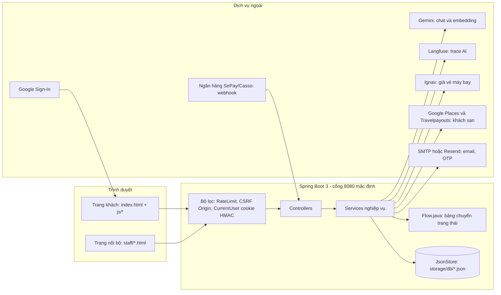
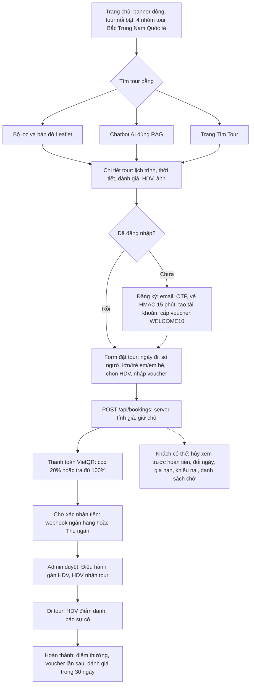
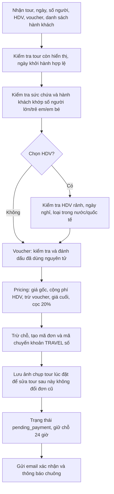
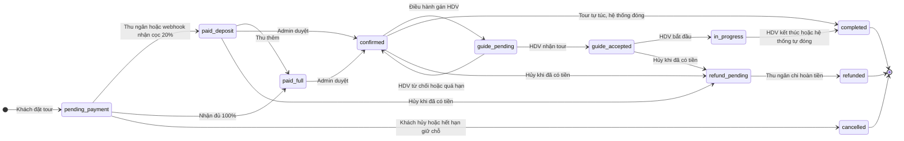
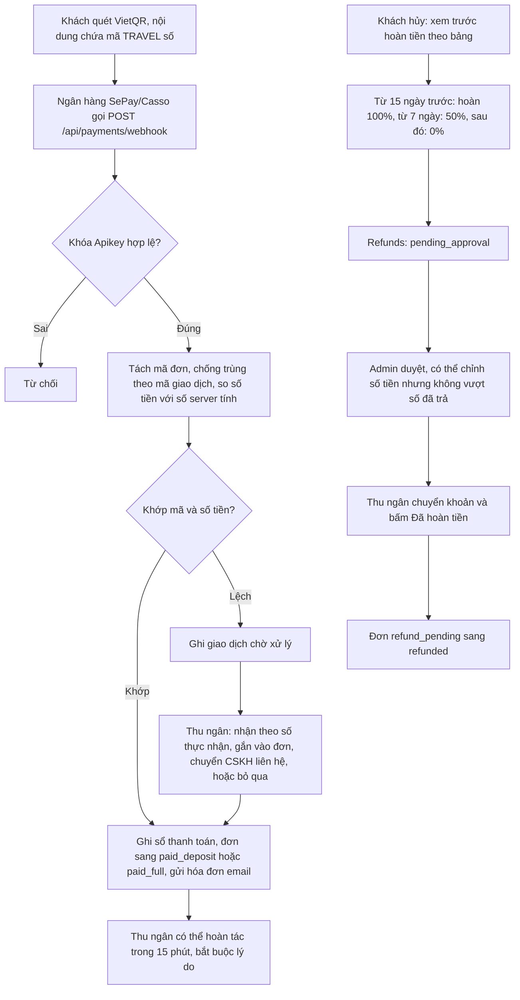
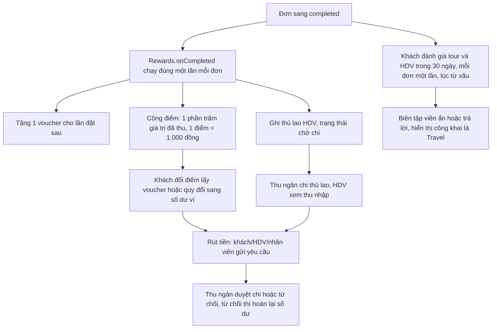
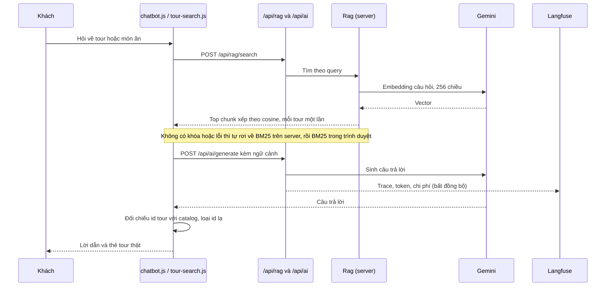

# Travel: workflow hệ thống đặt tour

Web đặt tour HTML/CSS/JS thuần, backend Spring Boot 3 lưu dữ liệu bằng file JSON. Trang này gom luồng khách hàng, vòng đời đơn, thanh toán, hoàn tiền, vai trò nội bộ và AI/RAG, dựa trên code và tài liệu trong Travel.zip.

Hệ thống đặt tour Travel gồm frontend HTML/CSS/JavaScript, backend Spring Boot và dữ liệu JSON. Sơ đồ dưới đây tóm tắt các luồng khách hàng, nhân viên và dịch vụ tích hợp được khai báo trong mã nguồn.

[Kiến trúc](#kien-truc)[Hành trình khách](#khach)[Tạo đơn](#dat-tour)[Vòng đời đơn](#vong-doi)[Thanh toán và hoàn tiền](#tien)[Sau tour](#sau-tour)[Vai trò](#vai-tro)[AI và RAG](#ai)[Bản đồ file](#file)[Lưu ý](#luu-y)

## 1. Kiến trúc tổng thể

Một ứng dụng Spring Boot phục vụ cả frontend tĩnh lẫn `/api` trên cùng origin. Mọi request API đi qua ba bộ lọc trước khi tới controller.

- **Giá luôn do server tính** (`Pricing.java`, đối chiếu `shared/pricing.js` bằng `pricing-cases.json`); client không gửi được giá.
- **Dữ liệu riêng tư** nằm ở `backend/storage/`, ngoài thư mục public; `StaticSiteConfig` chỉ cho phép danh sách trắng thư mục và trả 404 cho `.env`, `src/`, `storage/`.
- **Mất server** thì frontend rơi về chế độ dự phòng: RAG BM25 trong trình duyệt, dữ liệu tour tĩnh trong `frontend/data/`.

## 2. Hành trình của khách hàng

Từ lúc vào trang chủ đến khi đánh giá tour. Ba cách tìm tour dùng chung một lõi tìm kiếm (`tour-search.js`).

- Ngoài tour còn có **tìm khách sạn / chuyến bay** (`hotel-flight-search.js`): nguồn trực tuyến khi có khóa API, nếu không thì dùng danh mục tự quản trong `storage/db`.
- Khách còn có chuyến đi cá nhân (`trips.js`), yêu thích, so sánh tour, xuất Word/PDF, ví và điểm thưởng.

## 3. Server xử lý khi tạo đơn

`Bookings.create` làm toàn bộ trong khóa ghi của `bookings.json`, nên hai người đặt chỗ cuối cùng không thể cùng thành công.

## 4. Vòng đời đơn tour

Mọi thay đổi trạng thái đi qua `OpsCore.changeStatus`, hàm này tra bảng trong `Flow.java`, từ chối nếu sai thứ tự hoặc sai vai trò và ghi lịch sử.

- **Tách quyền:** Admin duyệt đơn nhưng không xác nhận tiền và không chi hoàn; Thu ngân làm hai việc đó. Người lập bản đóng sổ không tự duyệt bản của mình.
- **Tác vụ nền (`OpsSweeper`)** chạy với vai trò SYSTEM: hết hạn giữ chỗ, nhắc thu nốt, thu hồi tour khi HDV không trả lời, tự hoàn thành tour, nhắc khách trước ngày đi, báo Điều hành khi chưa đủ khách tối thiểu.

## 5. Thanh toán và hoàn tiền

Hai nhánh: khách chuyển khoản (tự động hoặc Thu ngân xác nhận tay) và hoàn tiền qua hai lớp duyệt.

- Nguồn hoàn tiền: khách hủy, Admin từ chối đơn, công ty hủy tour, khiếu nại (hoàn một phần, không đổi trạng thái đơn), gia hạn bị hủy, chênh lệch khi đổi ngày.
- **Gia hạn ngày** (`Extensions`): thu 100%, mã riêng `TRAVEL số-EXT n`; xin trước chuyến thì tự duyệt và chờ thanh toán, đang đi tour thì Điều hành duyệt. Chỉ khi đã trả mới cộng vào ngày kết thúc thực tế.
- **Thu nốt** sau chuyến: hạn = ngày kết thúc + 3 ngày; quá hạn thì báo Thu ngân và CSKH, không tự hủy.

## 6. Sau tour: thưởng, ví, đánh giá

Review và bình luận được công khai để các thành viên cùng xem. Khách đủ điều kiện gửi đánh giá sao sau tour; thành viên đăng bình luận/hỏi đáp tour hoặc ẩm thực, trả lời review/bình luận của nhau và đính kèm tối đa 5 ảnh mỗi bài/phản hồi. Ảnh được tải lên qua API và gắn với tài khoản người gửi. Bình luận tour và reply không tính điểm xếp hạng; thống kê tour chỉ nhận review đã xác minh booking. Review bị ẩn sẽ ẩn cả các phản hồi trong luồng. Chi tiết: Travel-Workflow-Review-Comment.md.

## 7. Vai trò và trang làm việc

Server kiểm quyền từng API (401 chưa đăng nhập, 403 sai quyền); ẩn menu ở giao diện chỉ là lớp thứ hai.

Khi phiên nội bộ còn hiệu lực, mọi vai trò kể cả Admin bị chuyển khỏi trang chủ/trang khách về dashboard riêng. Truy cập dashboard của vai trò khác cũng chuyển về trang làm việc của tài khoản; khách hàng không mở dashboard nhân viên. Đăng xuất hoặc dùng tài khoản khách để vào website khách hàng.

| Vai trò | Trang | Làm gì | Không được làm |
| --- | --- | --- | --- |
| Khách | Trang chủ | Đặt, hủy, đổi ngày, gia hạn, khiếu nại, đánh giá, ví | Vào khu nội bộ |
| Thu ngân | `staff/cashier` | Xác nhận cọc/đủ/thu nốt, xử lý lệch, hoàn tác, chi hoàn tiền, đóng sổ, chi thù lao, duyệt rút tiền | Duyệt đơn |
| Admin | `staff/admin` | Duyệt đơn, hoàn tiền, đóng sổ, nội dung, giá tour, voucher, nhân viên, cấu hình, thống kê, nhật ký, lương, thông báo | Xác nhận tiền, chuyển hoàn tiền |
| Điều hành | `staff/operator` | Gán/đổi/gỡ HDV, lịch khởi hành, sức chứa, sự cố, đề xuất hủy hoặc dồn tour, duyệt gia hạn | Xem tiền |
| CSKH | `staff/support` | Khiếu nại, đề xuất hoàn tiền, danh sách chờ, giao dịch lệch, đổi ngày hộ khách, tra cứu khách | Xem CCCD (luôn bị che) |
| Biên tập | `staff/content` | Bản nháp tour chờ Admin duyệt, ẩm thực, banner, tour nổi bật, ẩn/trả lời đánh giá | Sửa giá, HDV, sức chứa |
| HDV | `staff/guide` | Nhận/từ chối tour, bắt đầu/kết thúc, điểm danh, báo sự cố, lịch, báo cáo, thu nhập | Xem tiền, tour người khác |

- Nhân viên đăng nhập bằng email hoặc mã (ví dụ `tn001`). Phiên là cookie HttpOnly `travel_sid` ký HMAC-SHA256, có số phiên bản để thu hồi khi đổi mật khẩu, đổi vai trò hoặc khóa tài khoản.
- Nội bộ có hộp thông báo/hội thoại giữa các vai trò (`Messages`): Admin gửi thông báo cho một vai trò hoặc một người, người nhận chỉ trả lời riêng cho Admin.

## 8. AI chatbot và RAG

Khóa Gemini và Langfuse chỉ nằm ở server. Tìm tour luôn trả tour có thật vì id do AI chọn được đối chiếu lại với catalog.

- Chỉ mục: `RagChunker` cắt tour/món/UNESCO thành chunk ≤ 900 ký tự, lưu `vectors.json`, chỉ nhúng lại chunk mới hoặc đổi nội dung. Admin gọi `/api/admin/rag/reindex` sau khi sửa tour.
- Chatbot có cổng phạm vi: chỉ trả lời khi RAG tìm thấy dữ liệu Travel liên quan.

## 9. Bản đồ file trong Travel.zip

| Thư mục / file | Nội dung |
| --- | --- |
| `backend/src/main/java/vn/travel/web` | Controller và bộ lọc: Auth, Commerce (đặt đơn), Payment, Cashier, AdminOps, Operator, Support, Guide, ContentOps, Customer, Wallet, Message, Rag, Ai, Travel (vé/khách sạn), Upload, Seo; RateLimitFilter, CsrfFilter, CurrentUser |
| `backend/.../service` | Nghiệp vụ: Bookings, Payments, Refunds, Extensions, Rewards, WalletOps, Vouchers, Reviews, Messages, TourCatalog, Rag, AiProxy, OpsCore, OpsSweeper, CashierOps, StatsOps, Mailer, Otp, SessionService... |
| `backend/.../util` | `Flow` (máy trạng thái), `Pricing`, `PassengerRules`, `Capacity`, `RagChunker`, `HotelMatcher`, `ReviewSchema` |
| `backend/.../store, security, config` | `JsonStore`/`Db` (lưu JSON có khóa), `Role`/`Permission`/`RolePermissions` (RBAC), cấu hình và chặn file tĩnh |
| `backend/storage/db` | Dữ liệu chạy: accounts, bookings, payments, refunds, vouchers, reviews, vectors, config... |
| `backend/src/test` | Test không cần khóa thật: luồng đặt, quyền theo vai trò, thanh toán, CSRF, RAG, SEO, tính giá đối chiếu JS/Java |
| `frontend/index.html, js/, html/, css/` | Trang khách (SPA đơn giản bằng `navigate()` trong `main.js`), các mảnh HTML nhúng bằng `include.js` |
| `frontend/staff/` | 6 trang vai trò + `staff.js` lõi (đăng nhập, kiểm quyền, sidebar), `inbox.js`, `customers.js` |
| `frontend/shared/` | Mã dùng chung với server: `pricing.js`, `roles-permissions.js`, `review-schema.js` |
| `frontend/data/` | Tour mẫu 4 miền, địa điểm, ẩm thực, UNESCO, đánh giá mẫu |
| `docs/, README.md, TASKS-*.md, chuc-nang-can-lam-them.md` | Tài liệu vai trò/quyền, bản đồ JS, hiệu năng, thu hồi khóa, danh sách việc còn lại |
| `tools/, .github/workflows/ci.yml` | Script nâng toạ độ, đánh giá chatbot; CI chạy `mvn verify`, kiểm cú pháp JS, quét bí mật bằng gitleaks |

## 10. Điểm cần lưu ý khi kiểm tra

- **Có hai file `.env` trong zip** (gốc và `backend/`) với giá trị thật cho nhiều khóa (Gemini, Langfuse, email, Ignav...). Đã nằm trong `.gitignore`, nhưng zip đang mang theo. Nếu từng chia sẻ hoặc commit thì cần thu hồi theo `docs/SECRETS_ROTATION.md`. Khi nộp bài hoặc gửi người khác nên bỏ `.env`, `backend/storage/`, `backend/target/` và `tools/_archive_cleaned_files/`.
- `SESSION_SECRET` và `PAYMENT_WEBHOOK_SECRET` đang trống. Khóa phiên tự sinh vào `storage/db/.secret`, còn webhook thanh toán cần đặt secret trước khi chạy thật.
- Mã hiện tại trong `frontend/staff/admin.js` dùng các API `/api/admin/tours` cho thao tác quản lý tour; `AdminController` vẫn có endpoint đồng bộ tương thích `/api/admin/tours/sync`. Đây là mô tả theo mã nguồn, không theo ghi chú cũ trong README.
- Danh mục chuyến bay/khách sạn tự quản chưa trừ tồn kho; nguồn trực tuyến (Ignav, Places, Travelpayouts) chưa chạy thử với khóa thật.
- Thù lao HDV: comment trong `Rewards` ghi 20% giá tour, còn cấu hình mặc định là 500.000 đ/ngày (`guideFeePerDay`). Nên thống nhất một cách tính.
- Một số file rất lớn: `main.js` (\~138 KB), `staff/admin.js` (\~125 KB), `chatbot.js` (\~58 KB), khó bảo trì nếu tiếp tục phình.
