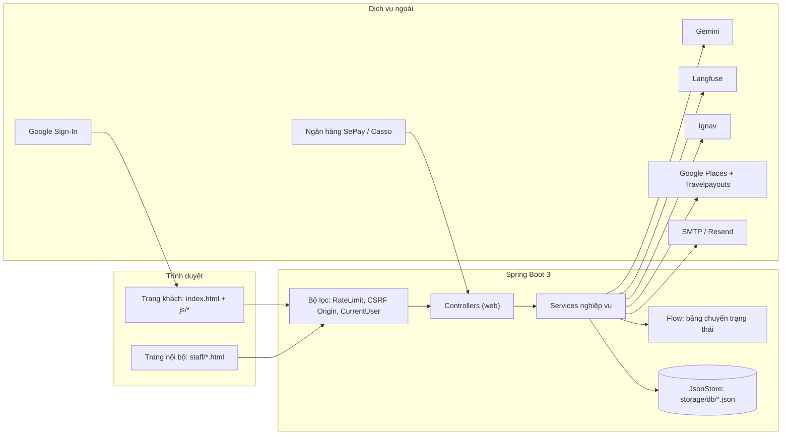
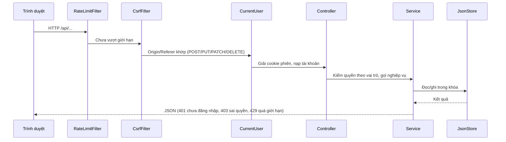
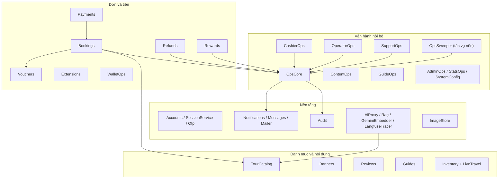
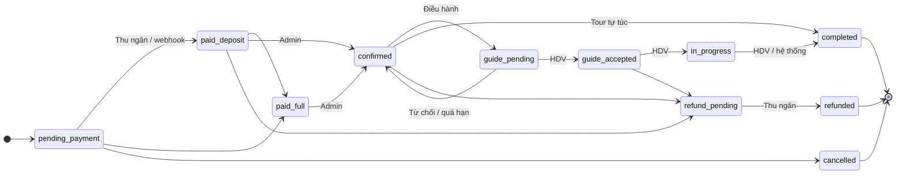
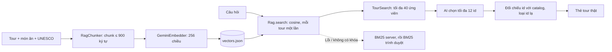
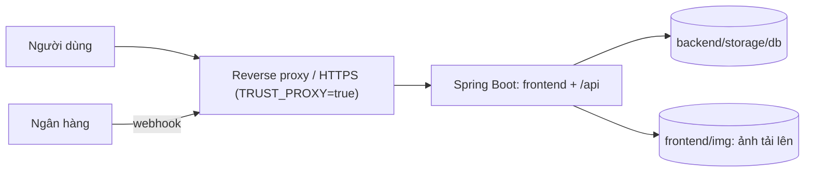

# Travel – Thiết kế kiến trúc phần mềm

Tài liệu mô tả kiến trúc của dự án **Travel** (web đặt tour), dựng từ mã nguồn và tài liệu trong `Travel.zip`.

---

## 1. Tổng quan

| Hạng mục | Nội dung |
| --- | --- |
| Loại hệ thống | Web đặt tour du lịch trong nước và quốc tế, có khu làm việc nội bộ theo vai trò |
| Frontend | HTML / CSS / JavaScript thuần, không framework, không bước build |
| Backend | Spring Boot 3 (Web + Validation), Java 17 |
| Lưu trữ | File JSON có khóa ghi (`JsonStore`), không SQL / JPA |
| Kiểu triển khai | Một ứng dụng Spring Boot phục vụ cả frontend tĩnh và `/api` trên cùng origin (mặc định cổng 8080) |
| Xác thực | Cookie phiên HttpOnly ký HMAC-SHA256, đăng nhập email/mật khẩu hoặc Google |
| Phân quyền | RBAC 7 vai trò, kiểm quyền từng API ở server |
| AI | Gemini (chat + embedding) qua server, trace bằng Langfuse |
| Kiểm thử / CI | `mvn verify`, kiểm cú pháp JS, quét bí mật bằng gitleaks |

### Mục tiêu thiết kế

1. **Server là nguồn sự thật**: giá, trạng thái đơn, quyền đều do server quyết định; client không gửi được giá.
2. **Tách quyền theo nghiệp vụ**: người duyệt đơn khác người thu tiền, khác người điều hành.
3. **Chạy được khi thiếu dịch vụ ngoài**: mọi tích hợp (AI, email, vé máy bay, khách sạn) đều có phương án rơi về dữ liệu nội bộ.
4. **Đơn giản để triển khai**: một tiến trình, dữ liệu là file JSON, không cần cơ sở dữ liệu riêng.

---

## 2. Kiến trúc tổng thể

### Các tầng

| Tầng | Vị trí | Trách nhiệm |
| --- | --- | --- |
| Giao diện khách | `frontend/index.html`, `js/`, `html/`, `css/` | Điều hướng bằng `navigate()` trong `main.js`; các mảnh HTML nhúng bằng `include.js` |
| Giao diện nội bộ | `frontend/staff/*` | 6 trang theo vai trò, lõi chung `staff.js` (đăng nhập, kiểm quyền, sidebar) |
| Mã dùng chung | `frontend/shared/` | `pricing.js`, `roles-permissions.js`, `review-schema.js`, đối chiếu với bản Java bằng test |
| Web / API | `backend/.../web` | Controller, bộ lọc, xử lý lỗi (`ApiExceptionHandler`, `HttpError`) |
| Nghiệp vụ | `backend/.../service` | Toàn bộ luật nghiệp vụ |
| Tiện ích miền | `backend/.../util` | `Flow`, `Pricing`, `PassengerRules`, `Capacity`, `RagChunker`, `HotelMatcher`, `ReviewSchema` |
| Bảo mật | `backend/.../security` | `Role`, `Permission`, `RolePermissions` |
| Lưu trữ | `backend/.../store` | `Db`, `JsonStore` |
| Cấu hình | `backend/.../config` | `TravelProperties`, `StaticSiteConfig`, `LiveTravelConfig`, `AppBeans` |

---

## 3. Chuỗi xử lý một request API

- **RateLimitFilter**: giới hạn theo IP cho đăng nhập, đăng ký, OTP, chat AI, voucher, review, RAG (30 lượt/phút/IP).
- **CsrfFilter**: mọi `POST/PUT/PATCH/DELETE` vào `/api/` phải có `Origin` (hoặc `Referer`) trùng origin của site (hoặc `SITE_URL`); `/api/payments/webhook` được miễn vì xác thực bằng khóa bí mật.
- **CurrentUser**: lấy người dùng từ cookie, vai trò đọc từ dữ liệu server, không tin client.

---

## 4. Các module nghiệp vụ

| Nhóm | Module chính | Vai trò |
| --- | --- | --- |
| Danh mục | `TourCatalog` | Nguồn duy nhất cho tour: gộp tour mẫu (`frontend/data`) với tour Admin (`admin-tours.json`), tour Admin ẩn thì biến mất ở mọi nơi |
| Đặt chỗ | `Bookings`, `Vouchers`, `Capacity`, `PassengerRules`, `Pricing` | Tạo đơn, tính giá, voucher, giữ chỗ |
| Tiền | `Payments`, `CashierOps`, `Refunds`, `Extensions`, `Rewards`, `WalletOps` | Thu, hoàn, gia hạn, điểm thưởng, ví |
| Vận hành | `OpsCore`, `OperatorOps`, `SupportOps`, `ContentOps`, `GuideOps`, `AdminOps`, `StatsOps` | Nghiệp vụ theo từng vai trò |
| Nền tảng | `Accounts`, `SessionService`, `Otp`, `Notifications`, `Messages`, `Mailer`, `Audit` | Tài khoản, phiên, thông báo, email, nhật ký |
| AI | `AiProxy`, `Rag`, `RagChunker`, `GeminiEmbedder`, `LangfuseTracer` | Chat, tìm kiếm ngữ cảnh, quan sát |
| Chuyến bay / khách sạn | `Inventory`, `LiveTravel`, `IgnavClient`, `PlacesClient`, `TravelpayoutsClient` | Danh mục tự quản hoặc nguồn trực tuyến |

### Thiết kế trung tâm: máy trạng thái đơn

`OpsCore.changeStatus` là **cổng duy nhất** đổi trạng thái đơn. Hàm tra bảng trong `Flow.java` (từ → sang → vai trò được phép), từ chối nếu sai thứ tự hoặc sai vai trò, và ghi lịch sử (ai, vai trò, lúc nào, từ đâu sang đâu).

Vai trò trong bảng: `CUSTOMER`, `CASHIER`, `OPERATOR`, `GUIDE`, `ADMIN`, `SUPPORT`, `CONTENT` và `SYSTEM` (việc tự động của server).

---

## 5. Phân quyền (RBAC)

| Vai trò | Trang | Phạm vi |
| --- | --- | --- |
| Khách (`user`) | Trang chủ | Đặt, hủy, đổi ngày, gia hạn, khiếu nại, đánh giá, ví |
| Thu ngân | `staff/cashier` | Xác nhận cọc / đủ / thu nốt, xử lý lệch, hoàn tác, chi hoàn tiền, đóng sổ, chi thù lao, duyệt rút tiền |
| Admin | `staff/admin` | Duyệt đơn, hoàn tiền, đóng sổ, nội dung, giá tour, voucher, nhân viên, cấu hình, thống kê, nhật ký, lương, thông báo |
| Điều hành | `staff/operator` | Gán / đổi HDV, khởi hành, sức chứa, sự cố, đề xuất hủy hoặc dồn tour, duyệt gia hạn |
| CSKH | `staff/support` | Khiếu nại, đề xuất hoàn tiền, danh sách chờ, giao dịch lệch, đổi ngày hộ khách |
| Biên tập | `staff/content` | Bản nháp tour, ẩm thực, banner, tour nổi bật, kiểm duyệt đánh giá |
| HDV | `staff/guide` | Tour của chính mình: nhận / từ chối, bắt đầu / kết thúc, điểm danh, sự cố, thu nhập |

**Nguyên tắc tách quyền**

- Admin không xác nhận nhận tiền và không chuyển tiền hoàn (việc của Thu ngân).
- Người lập bản đóng sổ không tự duyệt bản của mình.
- Biên tập không sửa giá, HDV, sức chứa; tour mới của biên tập là bản nháp chờ Admin duyệt.
- Điều hành không thấy tiền; HDV không thấy tiền và không thấy tour người khác.
- CSKH không thấy CCCD (luôn bị che). `OpsCore.view` cắt dữ liệu đơn theo vai trò.
- Ẩn menu ở giao diện chỉ là lớp phụ; server kiểm quyền từng API.

---

## 6. Kiến trúc dữ liệu

Dữ liệu chạy nằm ở `backend/storage/db/` (ngoài thư mục public, đã `.gitignore`).

| Nhóm | File | Nội dung |
| --- | --- | --- |
| Tài khoản | `accounts.json`, `.secret` | Tài khoản khách và nhân viên, khóa ký phiên tự sinh |
| Đơn và tiền | `bookings.json`, `payments.json`, `refunds.json`, `reconciliations.json`, `vouchers.json` | Đơn (kèm sổ thanh toán `payments[]` và lịch sử `history[]`), giao dịch, hồ sơ hoàn tiền, đóng sổ, voucher |
| Vận hành | `departures.json`, `guides.json`, `incidents.json`, `complaints.json`, `waitlist.json` | Chuyến khởi hành, hồ sơ HDV, sự cố, khiếu nại, danh sách chờ |
| Nội dung | `admin-tours.json`, `tour-drafts.json`, `banners.json`, `featuredpin.json`, `foods.json`, `reviews.json` | Tour Admin, bản nháp, banner, tour ghim, ẩm thực, đánh giá |
| Giao tiếp | `notifications.json`, `threads.json` | Chuông thông báo (tối đa 100 / tài khoản), hội thoại nội bộ |
| Hệ thống | `config.json`, `audit.json` | Cấu hình nghiệp vụ, nhật ký |
| Tìm kiếm | `vectors.json` | Vector embedding (khoảng 5 MB) |
| Chuyến bay / khách sạn | `airports.json`, `flights.json`, `hotels.json` | Danh mục tự quản |

**Dữ liệu tĩnh công khai** (`frontend/data/`): tour mẫu 4 nhóm (`mien-bac`, `mien-trung`, `mien-nam`, `quoc-te`), `tours-detail.json`, `locations.json`, `foods.json`, `unesco.json`, đánh giá mẫu.

**Nguyên tắc lưu trữ**

- Ghi qua `JsonStore` trong khóa theo file; sửa một đơn tại chỗ bằng `mutate`/`edit`.
- Thứ tự khóa luôn là `bookings` rồi `refunds`, không lồng ngược để tránh khóa chéo.
- Đơn lưu **ảnh chụp tour lúc đặt**, sửa tour sau này không làm đổi đơn cũ.
- Đơn đã có tiền hoặc đang hoạt động không xóa được; sổ thanh toán và lịch sử phải giữ lại.
- `LegacyMigration` chuyển đơn cũ sang sổ thanh toán khi khởi động.

---

## 7. Bảo mật

| Chủ đề | Cách làm |
| --- | --- |
| Phiên | Cookie HttpOnly `travel_sid` = `base64url(uid\|hạn\|v<ver>).HMAC-SHA256`; số phiên bản tăng khi đổi mật khẩu, đổi vai trò hoặc khóa tài khoản để thu hồi token cũ |
| Khóa ký | `SESSION_SECRET`; nếu trống thì tự sinh một lần vào `storage/db/.secret` |
| Mật khẩu | `PasswordHasher`; có server thì trình duyệt không lưu hash |
| Đăng ký | OTP email, server cấp "vé" ký HMAC gắn email, hiệu lực 15 phút |
| CSRF | Kiểm `Origin`/`Referer`, thiếu cả hai mà có cookie phiên thì 403 |
| Chống lạm dụng | `RateLimitFilter` theo IP, quá giới hạn trả 429 |
| Webhook thanh toán | Header `Authorization: Apikey <PAYMENT_WEBHOOK_SECRET>` hoặc `X-Webhook-Secret`, so sánh thời gian hằng |
| File tĩnh | Danh sách trắng thư mục; `storage/`, `.env`, `src/`, `pom.xml` luôn 404 |
| Điều hướng theo vai trò | Phiên nội bộ bị chuyển khỏi trang khách về dashboard đúng vai trò; chỉ được mở trang `/staff/<vai-trò>.html` của chính mình, kể cả Admin |
| Khóa dịch vụ ngoài | Chỉ ở server; ảnh khách sạn đi qua `/api/places/photo` để không lộ khóa |
| Tải ảnh | Kiểm chữ ký file (PNG/JPG/WEBP/GIF), tối đa 3 MB, tên file do server đặt |
| Nhật ký | `Audit` ghi hành động nhạy cảm; mỗi đổi trạng thái đơn có lịch sử |
| Quét bí mật | CI chạy gitleaks trên toàn bộ lịch sử git |

---

## 8. Tích hợp bên ngoài

| Dịch vụ | Dùng cho | Khi không có khóa / lỗi |
| --- | --- | --- |
| Gemini (`GEMINI_API_KEY`) | Chat AI, embedding 256 chiều | Chatbot dùng Mock AI; RAG rơi về BM25 |
| Langfuse | Trace, token, chi phí AI (bất đồng bộ) | Bỏ qua |
| SMTP (Gmail) hoặc Resend | Email xác nhận, hóa đơn, OTP | Đăng ký không bắt buộc OTP; có `OTP_DEV_LOG` để in mã ra console |
| SePay / Casso / PayOS | Webhook báo tiền về tài khoản | Thu ngân xác nhận tay |
| Ignav | Giá và liên kết đặt vé máy bay | Dùng danh mục `flights.json` |
| Google Places + Travelpayouts | Khách sạn: danh sách, ảnh, giá (ghép theo tên + toạ độ bằng `HotelMatcher`) | Dùng danh mục `hotels.json` |
| Google Sign-In | Đăng nhập Google | Dùng email/mật khẩu |
| Google Maps / Leaflet | Bản đồ tour | Leaflet là mặc định |
| Open-Meteo | Thời tiết điểm đến | Ẩn khối thời tiết |

Kết quả nguồn trực tuyến được nhớ trong RAM (`LIVE_CACHE_SECONDS`, mặc định 600 giây) và có rate limit theo IP.

---

## 9. AI và tìm kiếm (RAG)

- Chỉ nhúng lại chunk mới hoặc đổi nội dung (so hash); chunk không còn tồn tại bị xóa.
- Khởi động: có khóa mà chỉ mục thiếu thì tự lập chỉ mục ở luồng nền (`RagStartup`).
- Admin gọi `POST /api/admin/rag/reindex` sau khi sửa tour.
- Chatbot có cổng phạm vi: chỉ trả ngữ cảnh khi RAG tìm thấy dữ liệu Travel liên quan.

---

## 10. Tác vụ nền

`OpsSweeper` chạy với vai trò `SYSTEM`; mỗi bước độc lập, lỗi một bước không chặn các bước khác.

| Việc | Quy tắc mặc định |
| --- | --- |
| Hết hạn giữ chỗ | Đơn chưa thanh toán quá 24 giờ thì hủy, nhả chỗ và voucher |
| Hết hạn gia hạn chưa trả | Nhả lịch HDV đã giữ |
| HDV không trả lời | Quá 24 giờ thì thu hồi, đơn về `confirmed` |
| Nhắc thu nốt | Hạn = ngày kết thúc + 3 ngày; nhắc trước 2 ngày; quá hạn báo Thu ngân và CSKH, không tự hủy |
| Tự đóng đơn | Tour tự túc sau ngày kết thúc 1 ngày; tour có HDV tùy cấu hình |
| Nhắc khách | Trước ngày đi 1–2 ngày |
| Chốt khởi hành | Đến hạn chốt (3 ngày trước) mà chưa đủ khách tối thiểu thì báo Điều hành |
| Đơn bị bỏ quên | Cảnh báo |

### Cấu hình nghiệp vụ (`SystemConfig`, lưu `config.json`)

Chính sách hoàn tiền (≥15 ngày: 100%, ≥7 ngày: 50%, còn lại: 0%), giữ chỗ 24 giờ, hạn thu nốt 3 ngày, thù lao HDV 500.000 đ/ngày, hạn HDV trả lời 24 giờ, hoàn tác 15 phút, sức chứa mặc định 20, khách tối thiểu 2, gia hạn tối đa 2 ngày.

---

## 11. Triển khai và vận hành

- **Chạy**: `cd backend && cp .env.example .env && mvn spring-boot:run` (cổng mặc định 8080 theo `application.properties`; đổi `server.port` để dùng cổng khác).
- **Biến môi trường chính**: `ADMIN_EMAIL`, `ADMIN_PASSWORD`, `SESSION_SECRET`, `SITE_URL`, `GEMINI_API_KEY`, `LANGFUSE_*`, `EMAIL_*`, `PAYMENT_*`, `IGNAV_API_KEY`, `GOOGLE_*`, `TRAVELPAYOUTS_*`, `TRUST_PROXY`, `SAMPLE_DATA`.
- **Ổ đĩa phải bền**: `storage/db` và `frontend/img/` được ghi lúc chạy, không dùng ổ tạm của container; ảnh tải lên không tự vào Git.
- **SEO**: `SeoController` sinh `sitemap.xml`, `robots.txt`; `TourPageController` trả `index.html` kèm meta, Open Graph, JSON-LD cho từng tour.
- **`SAMPLE_DATA=false`** chỉ hiển thị dữ liệu thật (ẩn tour, đánh giá, HDV, banner mẫu).
- **CI** (`.github/workflows/ci.yml`): `mvn verify` trên Java 17, kiểm cú pháp `frontend/js/*.js`, quét bí mật.

---

## 12. Đánh đổi kiến trúc và rủi ro

| Quyết định | Lợi ích | Đánh đổi / rủi ro |
| --- | --- | --- |
| Lưu bằng file JSON | Không cần DB, dễ chạy và kiểm thử | Khó mở rộng nhiều tiến trình, truy vấn chậm khi `bookings.json` lớn (đang khoảng 1,8 MB), khóa theo file |
| Frontend thuần, file lớn | Không cần build | `main.js` (~138 KB), `staff/admin.js` (~125 KB), `chatbot.js` (~58 KB) khó bảo trì |
| Giá tính ở server, có bản JS để hiển thị | An toàn, khớp nhau nhờ test đối chiếu | Phải giữ hai bản `Pricing` đồng bộ |
| Một cổng đổi trạng thái (`Flow`) | Dễ kiểm quyền và truy vết | Mọi luồng mới phải đi qua bảng này |
| Quản lý tour Admin qua API backend; vẫn có endpoint tương thích `/api/admin/tours/sync` | Dữ liệu tour quản trị được xử lý ở server | Nên rà soát đồng bộ giữa các endpoint quản lý và luồng đồng bộ cũ khi thay đổi catalog |
| Danh mục chuyến bay / khách sạn tự quản | Có dữ liệu khi không có khóa | Chưa trừ tồn kho, chưa có màn hình Admin sửa danh mục |
| Nguồn trực tuyến (Ignav, Places, Travelpayouts) | Có thể trả dữ liệu từ nhà cung cấp khi cấu hình khóa | Cần kiểm tra với tài khoản và khóa của môi trường triển khai |

**Việc nên xử lý trước khi chạy thật**

1. Đặt `SESSION_SECRET` và `PAYMENT_WEBHOOK_SECRET`.
2. Thu hồi và đổi các khóa nếu `.env` từng bị chia sẻ (xem `docs/SECRETS_ROTATION.md`); không đưa `.env`, `backend/storage/`, `backend/target/` vào bản nộp hoặc bản chia sẻ.
3. Kiểm tra tính nhất quán giữa API quản lý tour và endpoint đồng bộ tương thích khi cập nhật catalog.
4. Thống nhất cách tính thù lao HDV: comment trong `Rewards` ghi 20% giá tour, cấu hình mặc định là 500.000 đ/ngày.
5. Tách các file JS lớn theo chức năng khi có thời gian.
