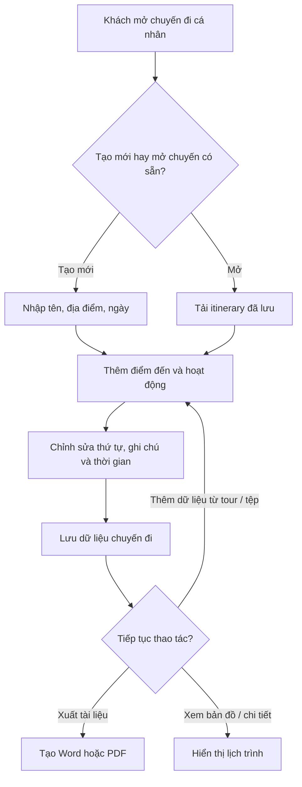

# Workflow 07 — Chuyến đi cá nhân

Chức năng trong `frontend/js/trips.js` lưu itinerary cá nhân bằng `localStorage` trên trình duyệt; hiện không thấy API backend đồng bộ itinerary cá nhân. Xuất Word/PDF và một số thao tác dùng dữ liệu trình duyệt.
