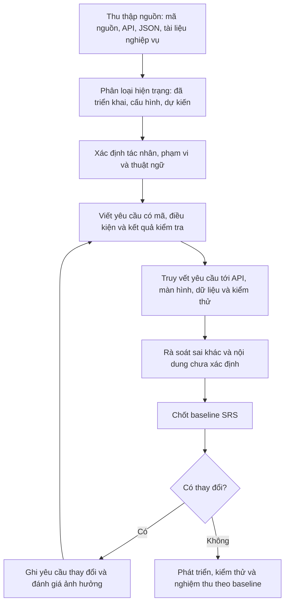
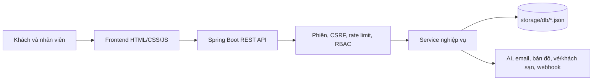

# Đặc tả yêu cầu phần mềm Travel

**Tài liệu:** Software Requirements Specification (SRS)  
**Phiên bản:** 1.0  
**Ngày:** 05-11-2026  
**Trạng thái:** Bản nền mô tả hệ thống hiện có, trích từ mã nguồn dự án Travel

## Lịch sử phiên bản

| Phiên bản | Ngày | Nội dung |
|---|---|---|
| 1.0 | 05-11-2026 | Tạo đặc tả từ frontend, backend, API, cấu trúc JSON và tài liệu nghiệp vụ hiện có. |

## 1. Giới thiệu

### 1.1 Mục đích

Tài liệu này xác định phạm vi, tác nhân, yêu cầu chức năng, yêu cầu chất lượng, giao diện, dữ liệu và tiêu chí nghiệm thu của Travel. Đây là bản mô tả **hệ thống đang có trong mã nguồn** để nhóm phát triển, kiểm thử và người đánh giá dùng chung một căn cứ. Tính năng phụ thuộc khóa dịch vụ được ghi rõ là phụ thuộc cấu hình; chức năng có trong danh sách dự kiến nhưng chưa có triển khai không được coi là yêu cầu đã hoàn thành.

### 1.2 Quy trình lập và duy trì SRS

Quy trình áp dụng cho dự án Travel:



1. **Thu thập:** đối chiếu controller/service Java, giao diện frontend, `JsonStore`, test, README và tài liệu nghiệp vụ.
2. **Phân loại:** đánh dấu từng năng lực là có trong mã, phụ thuộc cấu hình/nhà cung cấp, hoặc chưa được chứng minh là đã làm. Không chép yêu cầu của mẫu khác vào Travel.
3. **Đặc tả:** mỗi yêu cầu có mã duy nhất, tác nhân, điều kiện, kết quả quan sát được và mức ưu tiên hiện trạng.
4. **Truy vết:** nối mã yêu cầu với endpoint/màn hình, dữ liệu JSON và nhóm test phù hợp.
5. **Rà soát:** xác minh thuật ngữ, quyền, trạng thái, trường dữ liệu và các nhánh lỗi từ mã nguồn; ghi `TBD` nếu chưa có căn cứ định lượng.
6. **Chốt:** người phụ trách sản phẩm xác nhận phạm vi và các điểm TBD trước khi dùng tài liệu làm baseline triển khai.
7. **Thay đổi:** mọi yêu cầu mới/sửa đổi cần mã yêu cầu, lý do, ảnh hưởng API/data/permission/test, người chấp thuận và phiên bản SRS mới.
8. **Nghiệm thu:** cập nhật RTM và kết quả kiểm thử; không đánh dấu Done chỉ vì tài liệu hoặc giao diện đã được tạo.

### 1.3 Phạm vi sản phẩm

Travel là ứng dụng web du lịch có giao diện HTML/CSS/JavaScript và backend Spring Boot. Khách có thể khám phá tour, đặt dịch vụ du lịch, theo dõi đơn và tương tác với nội dung. Nhân viên xử lý đơn, thanh toán, điều hành tour, nội dung và hỗ trợ khách theo quyền. Dữ liệu nghiệp vụ được lưu bằng JSON trong backend.

### 1.4 Đối tượng đọc

| Đối tượng | Cách dùng tài liệu |
|---|---|
| Chủ dự án/giảng viên | Xác nhận phạm vi, phân biệt phần đã làm và phần cần bổ sung. |
| Lập trình viên | Tra cứu vai trò, quy tắc nghiệp vụ, API và dữ liệu liên quan. |
| Kiểm thử viên | Dùng yêu cầu và tiêu chí chấp nhận làm căn cứ lập test case. |
| Người bảo trì | Đánh giá ảnh hưởng khi sửa workflow, API, quyền hoặc JSON. |

### 1.5 Thuật ngữ

| Thuật ngữ | Ý nghĩa |
|---|---|
| SRS | Đặc tả yêu cầu phần mềm. |
| HDV | Hướng dẫn viên du lịch. |
| RAG | Truy xuất ngữ cảnh để hỗ trợ chatbot/tìm kiếm. |
| RBAC | Phân quyền theo vai trò. |
| JSON store | Cơ chế lưu object/list trong tệp JSON qua `JsonStore`. |
| Đơn | Bản ghi đặt tour, chuyến bay hoặc khách sạn trong `bookings.json`, phân biệt bằng loại đơn. |
| Catalog | Danh mục tour/nội dung hoặc inventory do Travel cung cấp. |
| TBD | Chưa có căn cứ trong mã/tài liệu để chốt yêu cầu; cần chủ dự án xác nhận. |

### 1.6 Tài liệu tham khảo

- Mẫu SRS `Doc_ITC.docx`: dùng tham khảo bố cục các phần SRS; nội dung nghiệp vụ mẫu không áp dụng cho Travel.
- `README.md`: cách chạy, công nghệ và phạm vi tính năng dự án.
- `docs/API_DOCUMENT.MD`: danh mục endpoint hiện có.
- `docs/Thiết kế database.md`: thiết kế lưu trữ JSON hiện có.
- `Travel – Workflow hệ thống.md`, `Travel-Software-Architecture.md`: luồng nghiệp vụ và kiến trúc.
- `docs/ROLES_PERMISSIONS.md`: vai trò và quyền.
- Mã nguồn `backend/src/main/java/vn/travel/` và `frontend/` là căn cứ kỹ thuật ưu tiên khi tài liệu khác biệt.

## 2. Mô tả tổng quan

### 2.1 Bối cảnh sản phẩm

Ứng dụng chạy cùng origin: Spring Boot 3.3.5/Java 17 phục vụ frontend tĩnh và API. Frontend không có bước build bắt buộc. Backend chia lớp controller, service, store, security và util; dữ liệu nghiệp vụ được lưu bằng tệp JSON. Dịch vụ bên ngoài chỉ hoạt động khi cấu hình tương ứng.



### 2.2 Chức năng trong phạm vi

- Tài khoản, đăng nhập email/Google, OTP, hồ sơ và khôi phục mật khẩu.
- Khám phá tour, bản đồ, tìm kiếm, trang chi tiết và đánh giá.
- Đặt tour, voucher, thanh toán chuyển khoản/QR, theo dõi trạng thái, hủy/đổi ngày/gia hạn theo điều kiện.
- Xử lý nghiệp vụ cho Admin, Thu ngân, Điều hành, CSKH, Biên tập và HDV.
- Tìm chuyến bay/khách sạn, chatbot/RAG, ví/điểm thưởng, thông báo và nội dung.
- Tạo chuyến đi cá nhân ở frontend; dữ liệu itinerary hiện lưu trên trình duyệt.

### 2.3 Ngoài phạm vi hoặc chưa xác nhận

- Hệ quản trị SQL, JPA, schema quan hệ hoặc giao dịch cơ sở dữ liệu: không có trong cấu hình hiện tại.
- Travel trực tiếp bán/thu tiền cho vé máy bay/khách sạn qua liên kết đối tác: kết quả live chuyển khách tới nhà cung cấp bên ngoài; chỉ inventory tự quản tạo booking Travel.
- Cam kết SLA, tải đồng thời, RPO/RTO, hiệu năng P95, hỗ trợ trình duyệt tối thiểu và chuẩn accessibility: chưa có mục tiêu định lượng được xác nhận (**TBD**).
- Tính năng được liệt kê trong `chuc-nang-can-lam-them.md` chỉ được đưa vào phạm vi sau khi kiểm tra mã và xác nhận trạng thái. Không mặc định coi kế hoạch là triển khai.

### 2.4 Ràng buộc và phụ thuộc

- JDK 17, Maven, Spring Boot 3.3.5; frontend HTML/CSS/JavaScript.
- Đường dẫn JSON mặc định `backend/storage/db/`; `WEB_ROOT`/`DB_DIR` có thể cấu hình.
- Google/Gemini/Langfuse/email/nhà cung cấp vé và khách sạn cần khóa hoặc tài khoản tương ứng.
- `SAMPLE_DATA` và `HIDE_SAMPLE_REVIEWS` ảnh hưởng dữ liệu mẫu hiển thị.
- Email OTP có chế độ phát triển; các tích hợp cần kiểm tra trong môi trường có cấu hình thật trước khi xác nhận vận hành.

## 3. Tác nhân và quyền

| Mã | Tác nhân | Mục tiêu và phạm vi chính |
|---|---|---|
| ACT-CUS | Khách hàng | Tìm và đặt dịch vụ, quản lý đơn của mình, thanh toán, đánh giá và gửi yêu cầu hỗ trợ. |
| ACT-ADM | Admin | Quản trị nhân sự/cấu hình/nội dung, duyệt đơn/hoàn tiền và xem báo cáo. |
| ACT-CAS | Thu ngân | Đối soát khoản thu, xác nhận thanh toán, thực hiện hoàn đã duyệt và lập sổ. |
| ACT-OPS | Điều hành | Quản lý chuyến khởi hành, phân công HDV và xử lý sự cố/điều phối. |
| ACT-SUP | CSKH | Tiếp nhận khiếu nại, phản hồi, hỗ trợ khách và đề xuất phương án. |
| ACT-CON | Biên tập | Quản lý bản nháp, món ăn, banner và kiểm duyệt đánh giá. |
| ACT-GDE | HDV | Xem tour được giao, nhận/từ chối, điểm danh, ghi nhận sự cố và kết thúc tour. |
| ACT-SYS | Hệ thống/dịch vụ ngoài | Tác vụ nền, webhook thanh toán, email và nhà cung cấp tích hợp. |

Backend dùng vai trò `CUSTOMER`, `ADMIN`, `CASHIER`, `OPERATOR`, `SUPPORT`, `CONTENT`, `GUIDE`. `SYSTEM` là tác nhân xử lý tự động, không phải tài khoản người dùng thông thường. Quyền cụ thể được định nghĩa tại `RolePermissions.java`.

## 4. Yêu cầu giao diện ngoài

### 4.1 Giao diện người dùng

- Giao diện khách nằm ở `frontend/index.html` cùng các trang/mảnh trong `frontend/html/`.
- Trang làm việc nhân viên nằm tại `/staff/<vai-trò>.html`.
- Khi phiên thuộc vai trò nội bộ (`ADMIN`, `CASHIER`, `OPERATOR`, `SUPPORT`, `CONTENT`, `GUIDE`) còn hiệu lực, truy cập `/`, `/index.html`, `/guide.html`, `/print.html` hoặc mảnh trang khách sẽ được chuyển về trang làm việc đúng vai trò. Kể cả `ADMIN` không dùng giao diện khách trong phiên nội bộ.
- Tài khoản nội bộ chỉ được mở trang `/staff/` tương ứng vai trò; mở trang của vai trò khác được chuyển về trang của mình. Khách hàng không mở được trang dashboard nhân viên.
- Các giới hạn điều hướng trên không thay thế RBAC: backend tiếp tục kiểm tra quyền trên từng API. Khách muốn dùng website khách hàng cần đăng xuất phiên nội bộ hoặc đăng nhập tài khoản khách.
- Giao diện cần báo lỗi, trạng thái chờ và dữ liệu rỗng theo phản hồi API hiện có. Hành vi responsive chi tiết/điểm gãy màn hình: **TBD** nếu cần tiêu chí nghiệm thu định lượng.

### 4.2 Giao diện API

- JSON UTF-8 cho request/response REST; cookie phiên HttpOnly; CSV cho các endpoint xuất danh sách đoàn; XML/text cho sitemap/robots; ảnh nhị phân cho proxy ảnh.
- Danh sách method/path chi tiết và payload mẫu nằm trong `API_DOCUMENT.MD`.
- Lỗi JSON thường có `ok=false`, `msg`, `error`, và `field` tùy trường hợp.

### 4.3 Giao diện dịch vụ ngoài

- Google Sign-In: xác minh credential qua backend.
- Gemini/Langfuse: sinh nội dung, embedding và trace nếu có cấu hình.
- Email/OTP: gửi email qua cấu hình nhà cung cấp; chế độ phát triển có thể ghi OTP vào log.
- Thanh toán: webhook được xác thực bằng secret header; không dựa trên cookie phiên người dùng.
- Ignav, Google Places, Travelpayouts: dữ liệu trực tuyến khi được bật; hệ thống có đường dự phòng theo code.

## 5. Yêu cầu chức năng

Mức ưu tiên `M` là năng lực lõi đang có trong mã nguồn; `S` là hỗ trợ/phụ trợ trong hệ thống. Đây là phân loại hiện trạng, không thay cho quyết định ưu tiên của chủ dự án.

### 5.1 Tài khoản và phiên

| ID | Yêu cầu | Tiêu chí chấp nhận tóm tắt | Ưu tiên |
|---|---|---|---|
| FR-AUTH-01 | Hệ thống phải cho phép người dùng đăng ký bằng email và thông tin tài khoản hợp lệ. | Email trùng/đầu vào sai bị từ chối; nếu OTP bắt buộc phải xác minh ticket; khi thành công tạo tài khoản và phiên. | M |
| FR-AUTH-02 | Hệ thống phải cho phép đăng nhập bằng email/mật khẩu hoặc Google credential được xác minh. | Thành công trả hồ sơ công khai và cookie phiên; sai thông tin không tạo phiên hợp lệ. | M |
| FR-AUTH-03 | Hệ thống phải hỗ trợ OTP, kiểm tra trạng thái OTP và khôi phục mật khẩu. | OTP sai/hết hạn không được dùng; đặt lại mật khẩu yêu cầu ticket hợp lệ khi OTP bật. | M |
| FR-AUTH-04 | Người dùng phải có thể xem/cập nhật hồ sơ và đăng xuất. | API chỉ trả dữ liệu công khai phù hợp; đăng xuất hết hiệu lực cookie hiện tại. | M |
| FR-AUTH-05 | Server phải xác thực vai trò/quyền từ dữ liệu phía server. | Không thể nâng quyền chỉ bằng sửa dữ liệu phía trình duyệt; thiếu phiên trả 401, thiếu quyền trả 403. | M |
| FR-AUTH-06 | Tài khoản nội bộ chỉ được truy cập dashboard của vai trò mình; khi còn phiên nội bộ, kể cả Admin, không được dùng trang chủ/giao diện khách. | Trang khách chuyển hướng về `/staff/<vai-trò>.html`; truy cập dashboard khác vai trò chuyển về dashboard riêng; khách không được mở dashboard nội bộ; đăng xuất vẫn cho phép vào trang khách. | M |

### 5.2 Khám phá và nội dung du lịch

| ID | Yêu cầu | Tiêu chí chấp nhận tóm tắt | Ưu tiên |
|---|---|---|---|
| FR-DISC-01 | Khách phải xem danh sách, tour nổi bật, vị trí và chi tiết tour. | API/file dự phòng cung cấp dữ liệu phù hợp; trang chi tiết hiển thị dữ liệu tour hiện có. | M |
| FR-DISC-02 | Khách phải tìm/lọc tour theo câu hỏi hoặc thuộc tính hỗ trợ. | Kết quả chỉ tham chiếu tour có trong catalog; khi AI/RAG lỗi dùng cơ chế xếp hạng dự phòng. | M |
| FR-DISC-03 | Khách phải xem nội dung món ăn, hướng dẫn viên và banner công khai. | Nội dung ẩn/không hoạt động không xuất hiện trong danh sách công khai. | S |
| FR-DISC-04 | Khách phải có thể lưu yêu thích/so sánh và tạo itinerary cá nhân. | Thao tác hoạt động theo frontend hiện tại; itinerary cá nhân lưu trên trình duyệt. | S |

### 5.3 Đặt tour và đơn dịch vụ

| ID | Yêu cầu | Tiêu chí chấp nhận tóm tắt | Ưu tiên |
|---|---|---|---|
| FR-BOOK-01 | Khách đã đăng nhập phải tạo đơn tour với ngày đi, khách, thông tin liên hệ và lựa chọn liên quan. | Server xác thực tour/ngày/số khách/sức chứa; giá được server tính; đơn mới có mã, trạng thái và lịch sử tạo. | M |
| FR-BOOK-02 | Hệ thống phải áp dụng voucher nếu mã, hạn và điều kiện của đơn hợp lệ. | Mã không hợp lệ không giảm giá; quy tắc được kiểm tra tại server. | M |
| FR-BOOK-03 | Khách phải xem danh sách/chi tiết đơn thuộc mình. | Không được đọc dữ liệu đơn của khách khác; response khách được lọc thông tin nội bộ. | M |
| FR-BOOK-04 | Khách phải xem trước việc hủy và yêu cầu hủy/đổi ngày/gia hạn theo chính sách. | Server xác nhận chủ đơn, trạng thái, điều kiện và tính khoản xử lý; thao tác sai trạng thái bị từ chối. | M |
| FR-BOOK-05 | Hệ thống phải cho phép khách gửi khiếu nại và tham gia danh sách chờ. | Tạo bản ghi gắn người dùng; CSKH xem và cập nhật theo quyền. | S |
| FR-BOOK-06 | Hệ thống phải hỗ trợ booking vé/khách sạn cho inventory tự quản. | Server kiểm tra sản phẩm và tự tính giá; booking ghi vào luồng đơn chung với loại dịch vụ phù hợp. | S |

### 5.4 Thanh toán, hoàn tiền và sổ quỹ

| ID | Yêu cầu | Tiêu chí chấp nhận tóm tắt | Ưu tiên |
|---|---|---|---|
| FR-PAY-01 | Hệ thống phải cung cấp thông tin chuyển khoản/QR theo đơn. | Thông tin thanh toán khớp đơn; mã/số tiền do server xác định. | M |
| FR-PAY-02 | Webhook phải xác thực secret và đối chiếu giao dịch trước khi ghi nhận thanh toán. | Giao dịch sai/mất xác thực không làm đổi trạng thái; webhook trùng được xử lý idempotent theo logic hiện tại. | M |
| FR-PAY-03 | Thu ngân phải xác nhận khoản thu, xử lý giao dịch sai lệch và hoàn tác có điều kiện. | Chỉ vai trò có quyền được thao tác; mọi chuyển trạng thái tuân thủ máy trạng thái và ghi lịch sử. | M |
| FR-PAY-04 | Admin phải duyệt/từ chối đề xuất hoàn; Thu ngân thực hiện khoản hoàn đã duyệt. | Không cùng một thao tác vừa duyệt vừa chi; đơn và refund thể hiện trạng thái phù hợp. | M |
| FR-PAY-05 | Thu ngân phải lập bản đối soát cuối ngày; người có quyền khác duyệt. | Người lập không tự duyệt bản của mình theo quy tắc nghiệp vụ. | S |

### 5.5 Vòng đời và vận hành tour

| ID | Yêu cầu | Tiêu chí chấp nhận tóm tắt | Ưu tiên |
|---|---|---|---|
| FR-OPS-01 | Điều hành phải xem chuyến khởi hành, sức chứa và hàng đợi phân công. | Kết quả theo quyền; danh sách đoàn có thể xuất CSV theo API hiện hành. | M |
| FR-OPS-02 | Điều hành phải gán/thay/gỡ HDV sau khi kiểm tra lịch và điều kiện. | HDV không khả dụng hoặc sai điều kiện bị từ chối; thay đổi được ghi lịch sử. | M |
| FR-GUIDE-01 | HDV phải xem và phản hồi các tour được giao. | HDV không được xem tour của người khác; nhận/từ chối cập nhật đơn hợp lệ. | M |
| FR-GUIDE-02 | HDV phải bắt đầu/kết thúc chuyến, điểm danh và ghi sự cố/báo cáo. | Chỉ trạng thái hợp lệ được chuyển; điểm danh và sự cố gắn tour/đơn tương ứng. | M |
| FR-SUPPORT-01 | CSKH phải tiếp nhận, trả lời, ghi nhận nội bộ và đề xuất xử lý khiếu nại. | Thao tác chỉ trong phạm vi quyền; đề xuất hoàn chuyển sang duyệt riêng. | M |

### 5.6 Đánh giá, ví và tương tác

| ID | Yêu cầu | Tiêu chí chấp nhận tóm tắt | Ưu tiên |
|---|---|---|---|
| FR-REV-01 | Khách gửi đánh giá tour xác thực sau khi đủ điều kiện; thành viên đăng bình luận tour hoặc ẩm thực. | Server kiểm tra đơn, thời hạn, giới hạn một review/đơn; bình luận tour không tạo rating giả; API công khai không lộ userId. | M |
| FR-REV-02 | Thành viên xem bài công khai, phản hồi trong luồng và đính kèm tối đa 5 ảnh. | Reply yêu cầu đăng nhập, 3–1000 ký tự, replyToId cùng luồng; ảnh kiểm chữ ký, kích thước, ownership; userId không lộ. | M |
| FR-REV-03 | Biên tập/Admin kiểm duyệt, ẩn/hiện và trả lời review theo quyền. | Ẩn review gốc ẩn cả reply; ẩn có lý do, hiện lại được; thao tác được ghi audit. | S |
| FR-WAL-01 | Khách phải xem điểm/ví và sử dụng quy đổi được hỗ trợ. | Số dư và điều kiện do backend tính; thay đổi lưu giao dịch theo logic dịch vụ. | S |
| FR-MSG-01 | Người dùng/nhân viên phải trao đổi qua chức năng hội thoại và nhận thông báo liên quan. | Chỉ người tham gia/role được phép xem hoặc thao tác hội thoại. | S |

### 5.7 Nội dung và quản trị

| ID | Yêu cầu | Tiêu chí chấp nhận tóm tắt | Ưu tiên |
|---|---|---|---|
| FR-CONT-01 | Biên tập phải tạo/gửi bản nháp tour và quản lý món ăn theo quyền. | Trường nhạy cảm bị chặn với Biên tập; bản nháp chờ Admin duyệt khi quy trình yêu cầu. | M |
| FR-CONT-02 | Admin phải quản lý tour, voucher, banner, nhân viên và cấu hình. | Endpoint kiểm quyền, validate trường nhạy cảm và ghi dữ liệu/audit phù hợp. | M |
| FR-ADMIN-01 | Admin phải duyệt đơn, đề xuất hoàn tiền, đóng sổ và xem thống kê/nhật ký. | Kết quả phản ánh trạng thái mới; quyền tài chính được phân tách theo vai trò. | M |
| FR-UP-01 | Người dùng/nhân viên được phép tải ảnh avatar/nội dung theo loại hỗ trợ. | Server kiểm loại/chữ ký file, kích thước và quyền; ảnh review tối đa 3 MB/tệp, 5 ảnh/bài, chỉ chủ tài khoản được gắn ảnh đã tải lên. | S |

### 5.8 Tìm kiếm AI và dịch vụ du lịch ngoài

| ID | Yêu cầu | Tiêu chí chấp nhận tóm tắt | Ưu tiên |
|---|---|---|---|
| FR-AI-01 | Hệ thống phải tìm ngữ cảnh tour/ẩm thực/UNESCO bằng RAG khi khả dụng. | Không có embedding/AI thì dùng BM25 phía server hoặc cơ chế dự phòng hỗ trợ; ID tour cuối cùng phải khớp catalog. | S |
| FR-TRAVEL-01 | Khách phải tìm chuyến bay/khách sạn qua nguồn trực tuyến hoặc catalog tự quản. | Trạng thái nguồn và lỗi dự phòng hiển thị phù hợp; link đối tác mở trang ngoài. | S |
| FR-SEO-01 | Server phải cung cấp sitemap/robots và metadata phù hợp trang tour. | Tour không tồn tại/ẩn không được index như trang tour hoạt động. | S |

## 6. Use case chính

### UC-01 Đăng ký/đăng nhập

- **Tác nhân:** Khách hàng.
- **Điều kiện trước:** Có kết nối tới backend; với đăng ký, email chưa dùng.
- **Luồng chính:** Người dùng gửi email/mật khẩu hoặc Google credential; server xác minh; tạo phiên cookie; trả hồ sơ công khai.
- **Ngoại lệ:** OTP thiếu/sai, thông tin sai hoặc tài khoản bị khóa; API trả lỗi và không cấp phiên sử dụng được.
- **Điều kiện sau:** Phiên hợp lệ hoặc thông báo lỗi; quyền được xác định từ tài khoản server.

### UC-02 Đặt tour

- **Tác nhân:** Khách hàng.
- **Điều kiện trước:** Đăng nhập; tour còn mở; ngày và số khách hợp lệ.
- **Luồng chính:** Chọn tour/ngày/số lượng, nhập thông tin hành khách, HDV/voucher tùy chọn; gửi yêu cầu; server tính giá, xác minh chỗ và ghi đơn; giao diện hiển thị mã đơn và hướng dẫn thanh toán.
- **Ngoại lệ:** Tour/ngày/chỗ/voucher/HDV không hợp lệ; server từ chối mà không chấp nhận giá do client tự gửi.
- **Điều kiện sau:** Đơn `pending_payment` được tạo hoặc request bị từ chối.

### UC-03 Thanh toán và duyệt đơn

- **Tác nhân:** Khách hàng, dịch vụ webhook, Thu ngân, Admin.
- **Điều kiện trước:** Đơn đang chờ thanh toán.
- **Luồng chính:** Khách chuyển khoản theo mã; webhook xác thực và đối chiếu, hoặc Thu ngân xác nhận thủ công; đơn cập nhật `paid_deposit`/`paid_full`; Admin duyệt; đơn thành `confirmed`.
- **Ngoại lệ:** Secret sai, không khớp mã/số tiền, giao dịch trùng hoặc trạng thái không hợp lệ; không ghi nhận sai khoản thu.
- **Điều kiện sau:** Đơn ở trạng thái thanh toán và duyệt tương ứng, có lịch sử.

### UC-04 Phân công và thực hiện tour

- **Tác nhân:** Điều hành, HDV, hệ thống.
- **Điều kiện trước:** Đơn đã xác nhận.
- **Luồng chính:** Điều hành chọn HDV hợp lệ; đơn chờ HDV nhận; HDV nhận, bắt đầu tour, điểm danh/ghi sự cố và kết thúc; hệ thống/HDV hoàn thành đơn theo quy tắc.
- **Ngoại lệ:** HDV bận/từ chối/quá thời gian; Điều hành được yêu cầu phân công lại theo quyền.
- **Điều kiện sau:** Đơn đi qua các trạng thái vận hành hợp lệ hoặc trở về chờ phân công.

### UC-05 Hủy và hoàn tiền

- **Tác nhân:** Khách hàng, CSKH, Admin, Thu ngân.
- **Điều kiện trước:** Đơn tồn tại và chưa ở trạng thái kết thúc không thể hủy.
- **Luồng chính:** Khách xem trước chính sách; gửi yêu cầu; server xác định khoản hoàn; Admin duyệt khi cần; Thu ngân thực hiện hoàn; trạng thái và lịch sử được cập nhật.
- **Ngoại lệ:** Đơn không thuộc khách, trạng thái không cho phép hoặc khoản hoàn chưa duyệt; trả lỗi/quyết định tương ứng.
- **Điều kiện sau:** Đơn bị hủy/chờ hoàn/đã hoàn theo luồng áp dụng.

## 7. Quy tắc nghiệp vụ và trạng thái

### 7.1 Trạng thái đơn tour

```text
pending_payment → paid_deposit | paid_full → confirmed → guide_pending
→ guide_accepted → in_progress → completed
```

Các trạng thái kết thúc/ngoại lệ gồm `cancelled`, `refund_pending`, `refunded`. Không phải mọi cạnh đều hợp lệ; `Flow.java` quy định tác nhân được phép chuyển giữa các trạng thái. Tour tự túc có thể chuyển từ `confirmed` sang `completed` bởi tác vụ hệ thống.

### 7.2 Quy tắc khác

- Giá tour/đơn được server tính; dữ liệu giá phía client chỉ để hiển thị.
- Quy tắc sức chứa, số khách, voucher, hạn thanh toán, chính sách hoàn, thời gian phản hồi và số ngày gia hạn do code/cấu hình áp dụng.
- Review xác thực yêu cầu đơn hoàn thành và bị giới hạn theo booking; API công khai không trả userId.
- Admin không xác nhận nhận tiền hoặc trực tiếp chuyển tiền hoàn; Thu ngân thực hiện nghiệp vụ tiền tương ứng.
- CSKH nhìn dữ liệu hành khách theo quyền che thông tin; HDV chỉ nhìn tour được phân công.

## 8. Yêu cầu phi chức năng

| ID | Yêu cầu | Căn cứ/tiêu chí hiện trạng |
|---|---|---|
| NFR-SEC-01 | Phiên đăng nhập phải bảo vệ khỏi truy cập trái phép. | Cookie HttpOnly, chữ ký HMAC, kiểm tra trạng thái/token version; cookie có SameSite=Lax và Secure khi HTTPS. |
| NFR-SEC-02 | Request ghi qua cookie phải chống CSRF. | Kiểm tra Origin/Referer; webhook thanh toán dùng xác thực secret riêng. |
| NFR-SEC-03 | API nhạy cảm phải kiểm tra quyền tại backend. | Role/permission được xác minh ở CurrentUser/controller/service; thiếu quyền trả 403. |
| NFR-SEC-04 | Khóa dịch vụ và dữ liệu riêng không được phục vụ công khai. | Secret lấy từ env; storage nằm ngoài web root; static config chặn đường dẫn nhạy cảm. |
| NFR-SEC-05 | Upload phải kiểm tra loại và kích thước. | Server xác minh chữ ký/tên loại được hỗ trợ và giới hạn kích thước theo cấu hình code. |
| NFR-SEC-06 | Giới hạn khu vực theo vai trò phải được thực thi phía server, không chỉ ẩn liên kết. | `StaticSiteConfig` định tuyến phiên nội bộ về dashboard đúng vai trò; từng API tiếp tục kiểm tra permission. |
| NFR-DATA-01 | Ghi một tệp JSON phải giảm nguy cơ ghi dở và mất cập nhật đồng thời trong cùng tiến trình. | Khóa theo file, ghi tệp tạm rồi rename; không bảo đảm transaction nhiều file hoặc nhiều instance. |
| NFR-ERR-01 | Lỗi API phải có cấu trúc nhất quán và không lộ stacktrace cho client. | Response thường có `ok,msg,error,field`; lỗi không xử lý trả thông báo tổng quát. |
| NFR-OPS-01 | Ứng dụng phải cho phép cấu hình các tích hợp ngoài. | Khóa/API URL/cổng/DB dir lấy từ cấu hình; dịch vụ ngoài có trạng thái và fallback theo code. |
| NFR-TEST-01 | Nghiệp vụ cốt lõi phải có kiểm thử tự động phù hợp. | Dự án có test cho auth, booking/flow, permission, payment, JSON store, RAG, SEO, upload và các phần khác. |
| NFR-PERF-01 | Hệ thống phải có mục tiêu thời gian phản hồi và tải đồng thời được thống nhất. | Giá trị đo/ngưỡng nghiệm thu chưa xác định trong mã nguồn (**TBD**). |
| NFR-AVAIL-01 | Hệ thống phải có mục tiêu availability, backup, RPO/RTO được thống nhất. | Mã nguồn không xác lập SLA/backup schedule; cần quyết định theo môi trường triển khai (**TBD**). |
| NFR-UX-01 | Giao diện phải hỗ trợ trình duyệt/kích thước màn hình mục tiêu. | Danh sách trình duyệt, breakpoint và tiêu chuẩn accessibility chưa được đặc tả định lượng (**TBD**). |

## 9. Thiết kế dữ liệu ở mức yêu cầu

Hệ thống lưu JSON, không có bảng SQL. Các collection chính gồm accounts, bookings, payments, refunds, vouchers, reviews, guides, departures, complaints, notifications, audit, content, inventory và RAG vectors. Các liên kết là ID logic; `API_DOCUMENT.MD` và `Thiết kế database.md` ghi chi tiết endpoint và collection.

Yêu cầu dữ liệu tối thiểu:

- ID bản ghi phải duy nhất trong collection liên quan.
- Đơn lưu thông tin cần thiết tại thời điểm đặt (snapshot) để thay đổi catalog không làm sai lịch sử đặt.
- Dữ liệu cá nhân/tài chính phải được lọc theo vai trò trước khi trả response.
- Ghi đồng thời xuyên nhiều tệp JSON chưa có transaction nguyên tử; các luồng tiền phải được kiểm tra riêng về tính nhất quán.

## 10. Yêu cầu giao diện API

API chuẩn hiện có và hợp đồng endpoint chi tiết được quy định ở `API_DOCUMENT.MD`. Nhóm API gồm:

| Nhóm | Prefix chính |
|---|---|
| Auth/OTP | `/api/auth`, `/api/otp` |
| Tour/nội dung/review | `/api/tours`, `/api/content`, `/api/reviews`, `/api/foods` |
| Booking/commerce/payment | `/api/bookings`, `/api/vouchers`, `/api/payments`, `/api/wallet` |
| Vai trò nhân viên | `/api/admin`, `/api/cashier`, `/api/operator`, `/api/support`, `/api/guide` |
| AI/tìm kiếm | `/api/ai`, `/api/rag` |
| Inventory du lịch | `/api/travel`, `/api/flights`, `/api/hotels`, `/api/places` |

Mọi thay đổi contract cần đồng bộ controller, frontend, quyền, lỗi, SRS và kiểm thử. Không giả định endpoint tồn tại chỉ từ tên chức năng trong tài liệu kế hoạch.

## 11. Tiêu chí nghiệm thu

1. Khách có thể đăng nhập và chỉ đọc/sửa dữ liệu thuộc phạm vi quyền của mình.
2. Tạo đơn tour hợp lệ tạo mã đơn, server tính giá, kiểm tra sức chứa và khởi tạo trạng thái đúng.
3. Thanh toán sai xác thực hoặc sai số tiền không làm đơn được đánh dấu đã thu; luồng hoàn tách duyệt và chi.
4. Các vai trò nhân viên chỉ truy cập chức năng được cấp; API trả 401/403 phù hợp khi không có phiên/quyền.
5. Luồng điều hành/HDV không cho chuyển trạng thái không hợp lệ; lịch sử thay đổi được giữ.
6. Hủy/đổi ngày/gia hạn/review tuân thủ điều kiện ở server, không chỉ dựa vào kiểm tra UI.
7. Khi khóa AI/live không có hoặc nhà cung cấp lỗi, hành vi dự phòng đúng như chức năng hiện hỗ trợ; giao diện không giả lập dữ liệu trực tuyến thành dữ liệu xác thực.
8. Tài liệu API, lưu trữ, SRS và RTM được cập nhật cùng lần thay đổi có ảnh hưởng.
9. Ngưỡng hiệu năng, availability, responsive và backup chỉ được nghiệm thu sau khi các giá trị TBD được chủ dự án xác nhận.

## 12. Ma trận truy vết yêu cầu

| Yêu cầu | Màn hình/module | API/điểm mã chính | Dữ liệu | Nhóm test tham khảo |
|---|---|---|---|---|
| FR-AUTH-01..06 | `auth.js`, profile, `/staff/` | `/api/auth/*`, `/api/otp/*`, `StaticSiteConfig` | accounts | `AccountsTest`, `OtpTest`, `CsrfFilterTest`, `StaticSiteConfigTest` |
| FR-DISC-01..04 | home, tour, finder, map, trips | `/api/tours`, `/api/locations`; `trips.js` | catalog tĩnh, admin-tours | `SampleDataAndTourApiTest`, `TourPageControllerTest`, `LocationsDataTest` |
| FR-BOOK-01..06 | booking, profile, travel search | `/api/bookings*`, `/api/bookings/{flight,hotel}` | bookings, departures, vouchers | `BookingFlowTest`, `TravelBookingTest`, `TravelInventoryTest`, `WelcomeVoucherTest` |
| FR-PAY-01..05 | payment, cashier, admin | `/api/payments/*`, `/api/cashier/*`, `/api/admin/refunds` | payments, refunds, reconciliations | `PaymentsTest`, `BookingFlowTest`, `RolePermissionsTest` |
| FR-OPS-01, FR-GUIDE-01..02 | staff/operator, staff/guide | `/api/operator/*`, `/api/guide/*` | departures, bookings, guides, incidents | `MessagesAndGuideTest`, `GuideAvailabilityTest`, `DepartureRulesTest` |
| FR-SUPPORT-01 | staff/support | `/api/support/*`, `/api/staff/customers/*` | complaints, waitlist, accounts | `CustomerDirectoryTest`, `RoleOpsTest` |
| FR-REV-01..03 | tour/food, members, staff/content | `/api/reviews*`, `/api/upload/review`, `/api/content/reviews*` | reviews, reviewmod, frontend/img/reviews | `ReviewsTest`, `ReviewSchemaTest`, `ContentTest`, `ImageStoreTest` |
| FR-WAL-01, FR-MSG-01 | profile, staff inbox | `/api/wallet/*`, `/api/messages*` | accounts, withdrawals, salary_logs, threads | `MessagesAndGuideTest`, `RemindAndCustomerNotiTest` |
| FR-CONT-01..02, FR-ADMIN-01 | staff/content, staff/admin | `/api/content/*`, `/api/admin/*` | admin-tours, tour-drafts, foods, audit, config | `ContentTest`, `TourCreateAndPermissionsTest`, `PrivilegeEscalationAndRoleMatrixTest` |
| FR-UP-01 | upload UI | `/api/upload/*` | filesystem `frontend/img/` | `ImageStoreTest`, `TourImagesTest` |
| FR-AI-01 | chatbot, tour finder | `/api/ai/*`, `/api/rag/*` | vectors | `AiProxyTest`, `RagTest`, `LangfuseTracerTest` |
| FR-TRAVEL-01 | hotel/flight search | `/api/travel/*`, `/api/flights/*`, `/api/hotels/*` | airports, flights, hotels, bookings | `LiveTravelTest`, `TravelInventoryTest`, `TravelBookingTest` |
| FR-SEO-01 | tour page | `/sitemap.xml`, `/robots.txt`, `TourPageController` | tour catalog | `SeoControllerTest`, `TourPageControllerTest` |

`RTM` là ánh xạ để lập kiểm thử; các test nêu trên là nhóm test có trong mã nguồn, không khẳng định mỗi tiêu chí ở bảng đã được bao phủ đầy đủ.

## 13. Rủi ro và điểm cần quyết định

| Mã | Rủi ro/điểm chưa chốt | Ảnh hưởng | Việc cần làm |
|---|---|---|---|
| R-01 | Lưu trữ JSON khóa trong một tiến trình, không transaction liên collection/đa instance. | Mất nhất quán khi tăng tải hoặc nhiều backend ghi cùng dữ liệu. | Xác định ngưỡng vận hành; cân nhắc database quan hệ nếu vượt giới hạn. |
| R-02 | Ngưỡng hiệu năng/SLA chưa định lượng. | Không thể nghiệm thu có căn cứ cho tải thực tế. | Chủ dự án chốt số liệu và cách đo. |
| R-03 | Tích hợp live phụ thuộc khóa và tài khoản bên ngoài. | Không xác nhận được kết quả thật ở môi trường chưa cấu hình. | Kiểm thử staging với khóa hợp lệ và giới hạn chi phí/quota. |
| R-04 | Một số tính năng trong tài liệu kế hoạch chưa được xác nhận trong code. | SRS có thể nhầm kế hoạch với khả năng hiện tại. | Kiểm tra bằng controller/UI và quản lý bằng backlog riêng. |
| R-05 | Giao diện itinerary cá nhân lưu cục bộ. | Dữ liệu không tự đồng bộ giữa thiết bị/trình duyệt. | Quyết định có đưa đồng bộ server vào phạm vi tương lai hay không. |

## 14. Phụ lục: nguồn căn cứ trong dự án

- Backend web/API: `backend/src/main/java/vn/travel/web/`.
- Nghiệp vụ: `backend/src/main/java/vn/travel/service/`.
- Quyền và trạng thái: `backend/src/main/java/vn/travel/security/`, `backend/src/main/java/vn/travel/util/Flow.java`.
- Lưu trữ: `backend/src/main/java/vn/travel/store/JsonStore.java`, `Db.java`.
- Frontend khách: `frontend/index.html`, `frontend/js/`, `frontend/html/`.
- Frontend nội bộ: `frontend/staff/`.
- Kiểm thử: `backend/src/test/java/vn/travel/`.

