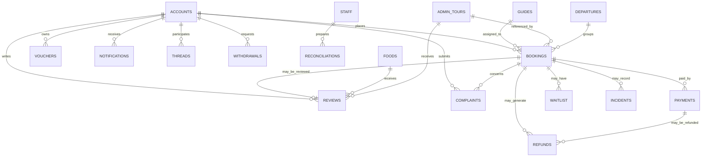

# Thiết kế dữ liệu Travel (JSON)

## 1. Mục đích và phạm vi

Tài liệu này mô tả **cách dự án hiện lưu dữ liệu**, sau khi đối chiếu `backend/src/main/java/vn/travel/store/JsonStore.java`, `Db.java`, các service/controller sử dụng store và tên các tệp trong `backend/storage/db/` của bản dự án được kiểm tra.

Travel hiện **không dùng hệ quản trị quan hệ**: không có schema SQL, bảng, JPA entity hay migration SQL. Backend dùng các tệp JSON trong `backend/storage/db/`. Mỗi tệp tương ứng một tập dữ liệu hoặc một tài liệu cấu hình. Quan hệ giữa các tập được biểu diễn bằng ID trong JSON và do service kiểm tra; đây là quan hệ logic, không có foreign key do database cưỡng chế.

Tệp runtime có dữ liệu tài khoản/đơn thật được xem là dữ liệu riêng tư. Tài liệu này chỉ ghi cấu trúc và vai trò, không đưa giá trị dữ liệu đang chạy, thông tin cá nhân hay bí mật vào đây.

## 2. Cơ chế lưu trữ hiện tại

- `TravelProperties.dbDir` cấu hình thư mục dữ liệu; mặc định trong `application.properties` là `storage/db` tương đối với backend.
- `Db.list(name)` đọc `{name}.json` dưới dạng mảng các object; `Db.obj(name)` đọc tài liệu JSON dạng object.
- `Db.edit/update` thực hiện đọc–sửa–ghi dưới khóa riêng theo tên tệp. Ghi dùng tệp tạm rồi đổi tên nguyên tử nếu hệ thống tệp hỗ trợ.
- `JsonStore` kiểm tra tên tệp theo mẫu chữ/số/gạch dưới/gạch ngang, giữ cache parse trong tiến trình và trả bản sao khi đọc.
- Cơ chế khóa chỉ áp dụng trong **một tiến trình Java** và trên **một tệp mỗi lần**. Hai tệp khác nhau không tham gia giao dịch nguyên tử chung.
- Một số tệp danh mục được nạp từ seed lần đầu. Tệp chưa tồn tại thường được xem như dữ liệu rỗng/default và có thể chỉ được tạo khi có thao tác ghi.

## 3. Tệp dữ liệu và mục đích

Tên dưới đây là tên collection trong store; hậu tố `.json` được thêm khi đọc/ghi. Hình dạng gốc được xác định theo kiểu API store: `Db.list/edit/update` là mảng; `Db.obj/editObj` là object. Một vài collection chỉ được tạo khi phát sinh nghiệp vụ.

| Nhóm | Tệp/collection | Hình dạng | Dữ liệu chính và mục đích |
|---|---|---|---|
| Tài khoản | `accounts.json` | Mảng object | Khách và nhân viên; thông tin đăng nhập/hồ sơ, role/status và một số số dư/điểm. Mật khẩu được lưu dạng hash theo dịch vụ xác thực. |
| Phiên | `.secret` | Tệp văn bản riêng | Bí mật ký phiên khi `SESSION_SECRET` chưa cấu hình; không phải collection JSON và không được chia sẻ. |
| Danh mục tour | `admin-tours.json` | Mảng object | Tour do Admin quản lý; catalog này được tham chiếu bởi mã tour trong đơn. |
| Bản nháp | `tour-drafts.json` | Mảng object | Nội dung tour chờ xử lý/duyệt. |
| Khởi hành | `departures.json` | Mảng object | Ngày khởi hành, sức chứa, trạng thái và dữ liệu điều hành liên quan. |
| Hướng dẫn viên | `guides.json` | Mảng object | Hồ sơ HDV, loại hình, khu vực, trạng thái và liên kết tài khoản nếu có. |
| Đơn hàng | `bookings.json` | Mảng object | Đơn tour, vé máy bay hoặc khách sạn; có loại đơn, khách, mã sản phẩm, số lượng, giá snapshot, trạng thái và thông tin khởi hành/thanh toán. |
| Thanh toán | `payments.json` | Mảng object | Giao dịch thu, mã đơn/thanh toán, số tiền, trạng thái và thông tin đối soát. |
| Hoàn tiền | `refunds.json` | Mảng object | Yêu cầu/khoản hoàn, đơn liên quan, số tiền và trạng thái duyệt/thực hiện. |
| Đối soát | `reconciliations.json` | Mảng object | Bản đối soát/đóng sổ, người lập, trạng thái và thông tin duyệt. |
| Doanh thu | `daily_revenues.json` | Mảng object | Tổng hợp doanh thu theo ngày phục vụ báo cáo/đóng sổ. |
| Yêu cầu hủy | `cancelproposals.json` | Mảng object | Đề xuất xử lý chuyến/đơn bị hủy và lựa chọn gửi khách. |
| Voucher | `vouchers.json` | Mảng object | Mã giảm giá, chủ sở hữu/nguồn cấp, điều kiện, hạn dùng và trạng thái sử dụng. |
| Đánh giá | `reviews.json` | Mảng object | Review xác thực, bình luận tour/ẩm thực; chứa ảnh và reply cộng đồng trong cùng bản ghi gốc. |
| Kiểm duyệt đánh giá | `reviewmod.json` | Object | Trạng thái ẩn/lý do và metadata kiểm duyệt review. |
| Nội dung | `banners.json`, `foods.json` | Mảng object | Banner và nội dung món ăn do hệ thống quản lý. |
| Thông báo | `notifications.json` | Mảng object | Thông báo gắn với người nhận/đối tượng nhận, thời gian và trạng thái đã đọc. |
| Hỗ trợ | `complaints.json`, `waitlist.json` | Mảng object | Khiếu nại/yêu cầu hỗ trợ và đăng ký danh sách chờ. |
| Tin nhắn | `threads.json` | Mảng object | Chủ đề trao đổi, người tham gia và các tin nhắn/metadata liên quan. |
| Điều hành | `incidents.json` | Mảng object | Sự cố tour và thông tin ghi nhận/xử lý. |
| Tài chính nhân sự | `withdrawals.json`, `salary_logs.json` | Mảng object | Yêu cầu rút/chi và nhật ký tính/thanh toán thù lao HDV. |
| Nhật ký | `audit.json` | Mảng object | Sự kiện quản trị/nghiệp vụ, tác nhân, hành động và thời điểm. |
| Cấu hình hệ thống | `config.json` | Object | Các tùy chọn nghiệp vụ Admin có thể chỉnh; giá trị mặc định nằm trong mã nguồn. |
| Ghim nổi bật | `featuredpin.json` | Object | Danh sách ID được ghim cho hiển thị nổi bật. |
| Sinh mã nhân viên | `staffseq.json` | Object | Bộ đếm/sequence cấp mã nhân viên. |
| RAG | `vectors.json` | Mảng object | Chunk, metadata và vector embedding dùng truy xuất ngữ cảnh; có thể được lập chỉ mục lại. |
| Danh mục vé/khách sạn | `airports.json`, `flights.json`, `hotels.json` | Mảng object | Danh mục tự quản; lần đầu có thể nạp từ `backend/src/main/resources/seed/`. |

Ngoài các tệp trên, giao diện còn có dữ liệu tĩnh trong `frontend/data/` (ví dụ catalog mẫu, địa điểm và dữ liệu mẫu). Những tệp này không phải collection do `JsonStore` quản lý. Dữ liệu trực tiếp từ Ignav/Google Places/Travelpayouts cũng không mặc nhiên trở thành bản ghi JSON lâu dài; một số kết quả được cache trong RAM.

### Cấu trúc review và phản hồi cộng đồng

`reviews.json` vẫn là mảng JSON hiện có; không cần migration SQL. Các trường mới/tùy chọn:

| Trường | Kiểu | Quy tắc |
|---|---|---|
| `id`, `userId` | string | ID nội bộ; userId không trả qua API công khai |
| `targetType`, `tourId`, `foodName` | string | Mục tiêu tour hoặc ẩm thực |
| `kind`, `source` | string | comment cho bài qua endpoint comment; source do server đặt |
| `rating` | integer/null | 1–5; chỉ review tour verified có bookingId tính vào điểm tour |
| `content`, `createdAt` | string | Nội dung và thời điểm ISO |
| `images` | string[] | Tối đa 5 URL HTTPS hoặc đường dẫn ảnh do chính tài khoản tải |
| `replies` | object[] | Reply phẳng: id, userId, name, content, createdAt, tùy chọn replyToId và images |
| `reply` | object | Phản hồi chính thức của Biên tập/Admin, riêng với replies cộng đồng |

Reply lưu trong record review gốc để ẩn/hiện cả luồng. replyToId chỉ tham chiếu bài gốc hoặc reply cùng luồng. Ảnh được lưu tại frontend/img/reviews/{slug-user-hash}/, tên ngẫu nhiên, chữ ký file được kiểm tra và giới hạn 3 MB/ảnh.

## 4. Quan hệ logic giữa dữ liệu

Các tên trường dưới đây mô tả khóa tham chiếu được service dùng theo nghiệp vụ; một số liên kết có thể tùy chọn tùy loại đơn hoặc lịch sử chuyển đổi.

`STAFF` trong sơ đồ là tài khoản nhân viên nằm trong `accounts.json`, không phải tệp riêng. `ADMIN_TOURS`, `FOODS` và các danh mục cũng có thể được tham chiếu bằng ID/tên sản phẩm thay vì join được bảo đảm. Lịch sử đơn có lưu snapshot để giữ lại thông tin/giá tại thời điểm đặt.

## 5. Luồng ghi dữ liệu tiêu biểu

### Đặt tour

1. Backend xác thực tài khoản, dữ liệu hành khách, ngày khởi hành, sức chứa và voucher.
2. Service tính lại giá phía máy chủ; client không phải nguồn giá đáng tin.
3. Service cập nhật `bookings.json` (và các collection liên quan như `departures.json`/`vouchers.json` tùy nghiệp vụ) để tạo đơn và giữ chỗ.
4. Thông tin thanh toán được quản lý trong `payments.json`; webhook hoặc Thu ngân cập nhật trạng thái thanh toán/đơn.
5. Duyệt, điều phối, hoàn tiền, khiếu nại và hoàn thành tour tiếp tục cập nhật các collection nghiệp vụ riêng và ghi audit khi áp dụng.

### Chỉnh sửa dữ liệu

Luồng thông thường đi qua controller → service → `Db` → `JsonStore`. Không nên chỉnh trực tiếp tệp JSON khi ứng dụng đang chạy: cache, quy tắc nghiệp vụ, khóa và các cập nhật liên quan có thể bị bỏ qua.

## 6. Tính toàn vẹn và giới hạn hiện tại

- Đây là **lưu trữ document/file**, không phải database quan hệ. Các kiểu trường và liên kết không được kiểm soát tập trung bằng schema cứng hoặc FK; validation phân tán trong service/controller.
- Mỗi cập nhật thường đọc và ghi lại cả collection. Khi tệp lớn, thời gian I/O và parse tăng; không có index truy vấn hay phân trang ở tầng lưu trữ.
- Khóa theo file bảo vệ thao tác đọc–sửa–ghi trong một tiến trình. Không có transaction nguyên tử xuyên `bookings`, `payments`, `vouchers`... và không có khóa phân tán giữa nhiều bản chạy.
- Đổi tên file nguyên tử giúp giảm nguy cơ file bị ghi dở, nhưng không thay thế backup hoặc giao dịch nhiều collection.
- `JsonStore.read` dùng fallback nếu file thiếu hoặc đọc/parse lỗi. Khi vận hành cần theo dõi file JSON hỏng và có backup trước khi sửa; không nên xem fallback là cơ chế phục hồi dữ liệu.
- Tệp JSON có thể chứa thông tin cá nhân và tài chính. Cần giới hạn quyền truy cập hệ điều hành, sao lưu an toàn, loại `backend/storage/` khỏi bản nộp/chia sẻ và không mở thư mục storage ra web.

## 7. Sao lưu và phục hồi

1. Dừng ứng dụng trước khi sao lưu để có bản nhất quán giữa nhiều tệp.
2. Sao chép toàn bộ `backend/storage/` sang vị trí riêng tư có kiểm soát quyền truy cập; không lưu chung với thư mục public.
3. Giữ thêm bản sao `.env`/secret trong kho bí mật riêng, tách khỏi bản backup dữ liệu và không commit vào Git.
4. Phục hồi khi ứng dụng dừng: khôi phục cả thư mục dữ liệu tương ứng, kiểm tra quyền đọc/ghi, cấu hình `DB_DIR` nếu có, rồi khởi động và rà log.
5. Kiểm tra định kỳ khả năng phục hồi từ backup; chỉ có bản sao mà chưa thử restore thì chưa xác nhận được kế hoạch phục hồi.

## 8. Khi nào nên chuyển sang database thật

Cân nhắc PostgreSQL/MySQL nếu cần nhiều instance backend, nhiều ghi đồng thời, giao dịch xuyên đơn/thanh toán/voucher, truy vấn/báo cáo lớn, phân trang/index, hoặc kiểm soát quan hệ và migration chặt chẽ. Khi chuyển đổi nên thiết kế schema từ các ID hiện có, viết migration/import có kiểm tra số lượng và đối soát, rồi chỉ chuyển nguồn dữ liệu chính sau khi đã xác minh dữ liệu.

## 9. Mã nguồn tham chiếu

- `backend/src/main/java/vn/travel/store/JsonStore.java` — đọc/ghi file, cache, khóa và ghi nguyên tử.
- `backend/src/main/java/vn/travel/store/Db.java` — API tiện ích cho collection dạng list/object.
- `backend/src/main/java/vn/travel/service/Bookings.java`, `Payments.java`, `Refunds.java` — đơn và thanh toán/hoàn tiền.
- `backend/src/main/java/vn/travel/service/Inventory.java` — danh mục sân bay, chuyến bay, khách sạn.
- `backend/src/main/java/vn/travel/service/Reviews.java`, `ContentOps.java` — đánh giá và kiểm duyệt.
- `backend/src/main/resources/application.properties` — đường dẫn mặc định `travel.db-dir`.
