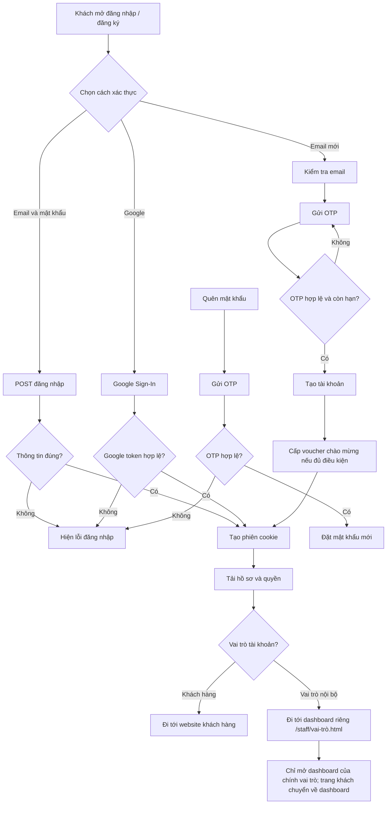

# Workflow 01 — Đăng ký và đăng nhập

**Các điểm xử lý:** backend xác thực OTP/token, tạo phiên và cấp quyền; frontend không tự quyết định danh tính. API chính: `/api/auth/*`, `/api/otp/*`.

Phiên nội bộ, kể cả Admin, không dùng được trang chủ, trang tour công khai, trang in của khách hoặc các mảnh giao diện khách. Tài khoản nội bộ chỉ vào dashboard đúng vai trò; backend thực hiện chuyển hướng và kiểm tra quyền API. Đăng xuất để kết thúc phiên nội bộ trước khi sử dụng giao diện khách.
