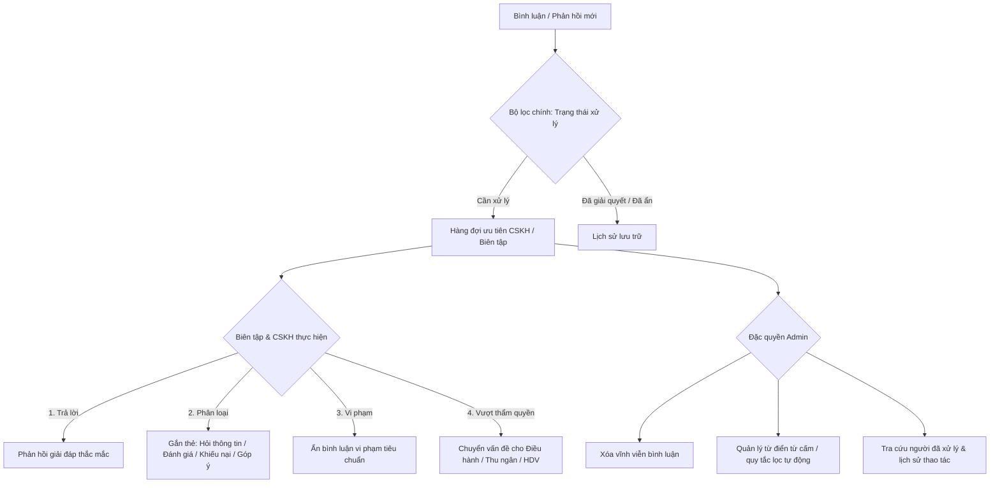

# Travel – Workflow đánh giá, bình luận, ảnh và phản hồi cộng đồng

Tài liệu mô tả review trên tour và ẩm thực: nhiều thành viên xem cùng nội dung công khai, gửi bình luận kèm tối đa 5 ảnh, phản hồi trong cùng luồng; khách đủ điều kiện gửi đánh giá sao xác thực cho tour. Dữ liệu lưu trong JSON reviews.json.

## 1. Các loại bài viết

| Loại | Ai đăng | Sao | Ảnh | Có tính vào điểm tour |
|---|---|---|---|---|
| Đánh giá tour xác thực | Khách đã hoàn thành đơn, trong cửa sổ 30 ngày, một lần/đơn | Bắt buộc 1–5 | Tối đa 5 | Có |
| Bình luận/hỏi đáp tour | Tài khoản đăng nhập | Không có điểm | Tối đa 5 | Không |
| Đánh giá/bình luận ẩm thực | Tài khoản đăng nhập | Tùy chọn 1–5 | Tối đa 5 | Không tính điểm tour |
| Phản hồi cộng đồng | Tài khoản đăng nhập | Không có điểm | Tối đa 5 | Không |
| Phản hồi chính thức | Biên tập/Admin có quyền kiểm duyệt | Không có điểm | Chưa hỗ trợ ảnh | Không |

source, userId, thời gian và mã bài viết do server quyết định. Dữ liệu công khai không trả userId; tên hiển thị giúp thành viên nhận biết nhau. Bình luận tour không được gửi rating và không tham gia thống kê tour.

## 2. Luồng đăng bài và tải ảnh

~~~mermaid
sequenceDiagram
  actor U as Thành viên
  participant UI as tour-page.js / food-page.js
  participant UP as POST /api/upload/review
  participant API as POST /api/reviews hoặc /comment
  participant DB as ImageStore + reviews.json
  U->>UI: Chọn nội dung và tối đa 5 ảnh
  UI->>UI: Thu nhỏ ảnh trên trình duyệt thành JPEG
  loop Mỗi ảnh
    UI->>UP: JSON dataUrl
    UP->>UP: Xác thực phiên, chữ ký file, định dạng, giới hạn 3 MB
    UP->>DB: Ghi ảnh dưới img/reviews/{tài khoản}/
    UP-->>UI: Đường dẫn ảnh
  end
  UI->>API: Gửi bài + danh sách đường dẫn ảnh
  API->>API: Kiểm tra nội dung, tối đa 5 ảnh, ảnh local thuộc chính tài khoản
  API->>DB: Ghi bài vào reviews.json
  API-->>UI: Bài viết công khai đã lọc dữ liệu riêng tư
  UI->>U: Hiển thị bài, ảnh và luồng phản hồi
~~~

Ảnh chỉ nhận PNG/JPEG/WEBP/GIF; server kiểm tra chữ ký, kích thước tối đa 3 MB/ảnh, không tin MIME từ trình duyệt. Tệp được đặt tên ngẫu nhiên trong thư mục của tài khoản tải lên. Ảnh HTTPS ngoài hệ thống có thể được đính kèm; liên kết HTTP và data URL bị từ chối.

## 3. Luồng trả lời cộng đồng

~~~mermaid
flowchart TD
  A[GET /api/reviews công khai] --> B[Hiển thị review/bình luận cùng ảnh]
  B --> C{Đã đăng nhập?}
  C -- Chưa --> D[Chỉ xem; đăng nhập để phản hồi]
  C -- Rồi --> E[POST /api/reviews/{id}/replies]
  E --> F{Review gốc đang hiển thị?}
  F -- Không --> X[404]
  F -- Có --> G{replyToId rỗng hoặc trỏ vào cùng luồng?}
  G -- Không --> Y[400]
  G -- Có --> H[Lọc từ ngữ xấu, kiểm tra ảnh sở hữu]
  H --> I[Lưu replies[] trong review gốc]
  I --> J[Trả lời xuất hiện công khai; userId không lộ]
~~~

Trả lời sâu được lưu phẳng trong replies[] với replyToId, tránh cây lồng sâu. Thành viên có thể trả lời review gốc hoặc một reply trong luồng. Ẩn review gốc sẽ ẩn cả luồng; reply không có điểm sao và không ảnh hưởng xếp hạng.

## 4. API liên quan

| Method | Endpoint | Quyền và tác dụng |
|---|---|---|
| GET | /api/reviews?tourId=…&targetType=… | Công khai; trả bài đã làm sạch, ảnh, phản hồi, thống kê |
| GET | /api/reviews/eligible?tourId=… | Đăng nhập; kiểm tra đánh giá tour xác thực |
| POST | /api/reviews | Đăng nhập + đơn tour đủ điều kiện; đánh giá sao xác thực |
| POST | /api/reviews/comment | Đăng nhập; bình luận tour hoặc bài ẩm thực |
| POST | /api/reviews/{id}/replies | Đăng nhập; body content, tùy chọn replyToId, images |
| POST | /api/upload/review | Đăng nhập; body {dataUrl}; lưu ảnh của chính người tải |
| GET/POST | /api/content/reviews, /api/content/reviews/{id}/moderate, /reply | Quyền kiểm duyệt |

Giới hạn theo IP: đánh giá xác thực 5/phút, bình luận 10/phút, phản hồi 20/phút, tải ảnh review 20/phút. Giới hạn 3 MB/ảnh và tối đa 5 ảnh/bài.

## 5. Thống kê và kiểm duyệt

- Thống kê/ranking tour chỉ cộng rating có source=verified, bookingId và targetType=tour (hoặc trường loại vắng mặt ở dữ liệu cũ); bình luận thường, reply và bài ẩm thực không được tính.
- GET công khai loại bỏ ID tài khoản và trường nội bộ của reply; giữ tên hiển thị, nội dung, thời gian, ảnh hợp lệ.
- Review bị kiểm duyệt ẩn sẽ cùng lúc ẩn reply của nó.
- Bài seed được sao chép vào reviews.json khi thành viên phản hồi lần đầu.
- Phản hồi chính thức reply độc lập với replies[] của cộng đồng.

## 7. Phân quyền xử lý bình luận giữa Admin và Biên tập & CSKH

Nhằm tối ưu hóa tốc độ phản hồi và bảo vệ dữ liệu hệ thống, luồng quản trị bình luận được phân định rõ ràng giữa 2 cấp độ:

### 7.1 Ma trận phân quyền chi tiết

| Quyền hạn | Biên tập & CSKH | Admin | Ghi chú nghiệp vụ |
| :--- | :---: | :---: | :--- |
| **Xem danh sách bình luận** | Có | Có | Truy cập tại portal `/staff/content.html` hoặc `/staff/support.html` |
| **Trả lời khách hàng** | Có | Có | Phản hồi hiển thị công khai dưới danh nghĩa CSKH / Ban quản trị |
| **Ẩn bình luận vi phạm** | Có | Có | Ẩn tạm thời khỏi giao diện khách, bảo toàn dữ liệu phục vụ đối soát |
| **Gắn phân loại** | Có | Có | 4 nhãn: `Hỏi thông tin`, `Đánh giá`, `Khiếu nại`, `Góp ý` |
| **Chuyển vấn đề** | Có | Có | Tạo phiếu chuyển giao sang Điều hành (lịch trình), Thu ngân (tiền), HDV (thái độ) |
| **Bộ lọc chính** | **Cần xử lý** | **Cần xử lý** | Tuyệt đối không dùng filter "Admin trả lời / Biên tập trả lời" làm filter chính |
| **Xóa vĩnh viễn** | ❌ Không | **Có** | Xóa hoàn toàn bản ghi khỏi `reviews.json`, chỉ Admin được thao tác |
| **Cấu hình quy tắc lọc** | ❌ Không | **Có** | Thêm bớt từ cấm, cấu hình bộ lọc spam tự động |
| **Xem lịch sử xử lý** | ❌ Không | **Có** | Hiển thị chi tiết: Ai đã ẩn, ai đã gắn tag, thời gian xử lý |

---

## 8. Luồng phản hồi Form chân trang (Footer Feedback)

- **Thu thập yêu cầu**: Tại form liên hệ / phản hồi dưới footer website, khách hàng gửi họ tên, email, số điện thoại và nội dung cần hỗ trợ.
- **Tiếp nhận & Phân loại**:
  - Dữ liệu lưu vào hàng đợi chăm sóc khách hàng.
  - CSKH nhận thông báo chuông trên thanh tác vụ.
  - Tự động phân loại nguồn: `Web Footer Contact`.
- **Xử lý phản hồi**:
  - CSKH bấm trực tiếp vào phiếu yêu cầu để gửi email giải đáp hoặc gọi điện thoại tư vấn.
  - Cập nhật trạng thái phiếu: `Đang liên hệ` -> `Đã giải quyết`.

---

## 9. Tệp mã nguồn và dữ liệu

- Backend: `Reviews.java`, `ReviewSchema.java`, `ContentOps.java`, `ContentController.java`, `SupportOps.java`.
- Frontend: `frontend/staff/content.js`, `frontend/staff/support.js`, `frontend/js/review-community.js`, `frontend/html/footer.html`.
- Dữ liệu lưu trữ: `storage/db/reviews.json`, `storage/db/complaints.json`, `storage/db/audit_logs.json`.

