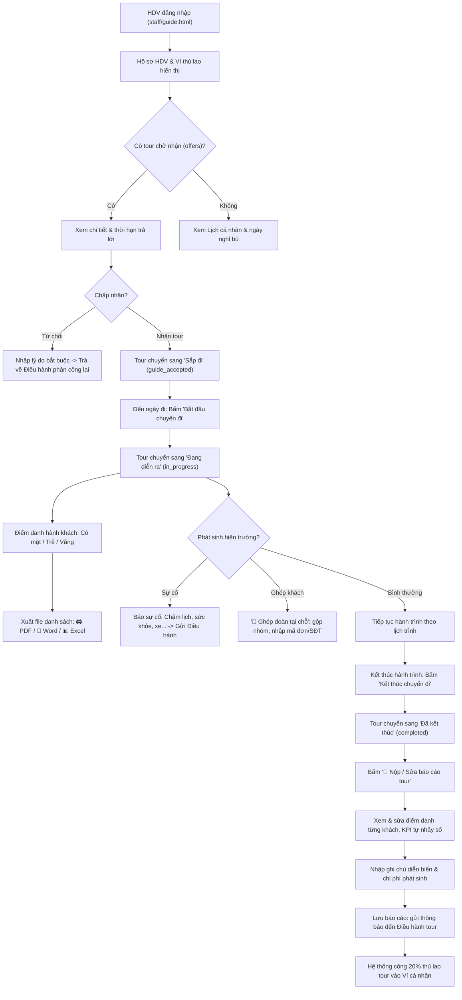

# Workflow 11 — Hướng dẫn viên (Guide Operations)

Tài liệu mô tả toàn bộ vòng đời tác nghiệp của Hướng dẫn viên (HDV) từ khi nhận tour, điểm danh xuất bến, xử lý sự cố hiện trường, ghép đoàn tại chỗ đến kết thúc tour, nộp báo cáo và quản lý ví thù lao.

---

## 1. Sơ đồ luồng tác nghiệp HDV

---

## 2. Các tính năng nghiệp vụ chi tiết

### 2.1. Phân quyền và Bảo mật dữ liệu
* HDV chỉ thấy các tour được phân công cho chính mình (`own(guideId, bookingId)`).
* Không hiển thị số tiền thanh toán hoặc giá tour của khách (chỉ thấy danh sách khách, điểm đón, yêu cầu đặc biệt).
* Thanh tiêu đề luôn hiển thị số dư ví thù lao thực tế: **`💳 Thù lao tour: xx.xxx.xxx ₫`**.

### 2.2. Điểm danh và Xuất danh sách đoàn
* Điểm danh từng khách theo 3 trạng thái: `Có mặt` (present), `Đến trễ` (late), `Vắng` (absent).
* Nếu toàn bộ khách vắng, đơn tự động bị đánh dấu `noShow` và chặn khách đánh giá ảo.
* Tích hợp thanh công cụ xuất phiếu điểm danh: In trực tiếp, tải PDF, xuất Word hoặc Excel bảng danh sách hành khách đoàn.

### 2.3. Nghiệp vụ Ghép đoàn tại chỗ (`guideMergeDialog`)
* Áp dụng khi dẫn tour gặp nhóm khách đi cùng tuyến điểm hoặc gộp xe trung chuyển theo chỉ đạo của Điều hành.
* Nhập mã đơn / SĐT khách ghép + số lượng khách ước tính + lý do ghi chú hiện trường.
* Gửi `POST /api/guide/tours/pool/merge-onsite` để cập nhật dữ liệu vận hành.

### 2.4. Báo cáo tour tổng kết (`reportDialog`)
* Hiển thị bảng danh sách hành khách đi kèm dropdown chọn trạng thái điểm danh thực tế.
* Có các nút bấm nhanh: `✅ Tất cả có mặt`, `⏱️ Tất cả trễ`, `❌ Tất cả vắng`, `🔄 Đặt lại`.
* Các chỉ số KPI (Tổng khách, Có mặt, Đến trễ, Vắng, Chưa điểm danh) tự động nhảy số theo thời gian thực.
* Nhập ghi chú diễn biến đoàn và chi phí phát sinh (vé gửi xe, chi phí đột xuất).
* Khi nộp báo cáo, hệ thống tự động cập nhật danh sách hành khách trong đơn và gửi thông báo cho Điều hành tour.
