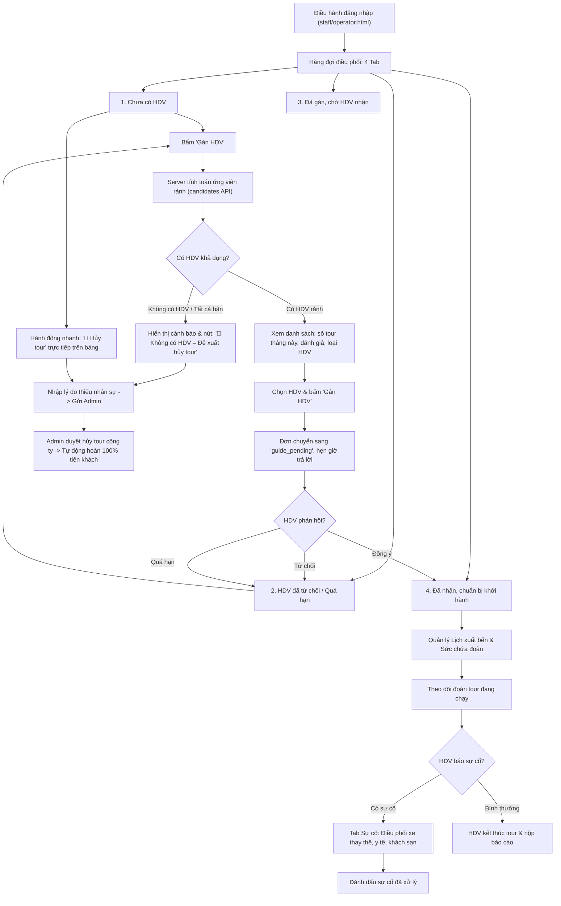

# Workflow 12 — Điều hành tour (Tour Operations)

Tài liệu mô tả quy trình vận hành và điều phối của bộ phận Điều hành tour: quản lý danh sách đơn chờ điều hành, phân công HDV, đề xuất hủy tour khi thiếu nhân sự, theo dõi xuất bến và xử lý sự cố đoàn.

---

## 1. Sơ đồ luồng Điều hành tour

---

## 2. Các nghiệp vụ trọng yếu

### 2.1. Tối ưu phân công ứng viên HDV (`candidates`)
* Hệ thống tự động lọc danh sách 16 HDV:
  * Loại trừ các HDV bị trùng lịch tour vào ngày khởi hành hoặc đang trong thời gian nghỉ bù.
  * Ưu tiên HDV có ít tour nhất trong tháng để cân đối khối lượng công việc.
  * Phân biệt rõ loại HDV phù hợp: Tour nội địa yêu cầu thẻ HDV nội địa (`domestic`), Tour quốc tế yêu cầu thẻ quốc tế (`international`).

### 2.2. Đề xuất hủy tour do thiếu HDV (`Cancel Proposals`)
* **Bối cảnh:** Khi vào mùa cao điểm hoặc toàn bộ HDV phù hợp đều đã kín lịch, Điều hành không thể gán người dẫn đoàn.
* **Thao tác:**
  * Bấm nút **`🚫 Không có HDV – Đề xuất hủy tour`** ngay trong popup phân công khi danh sách ứng viên trống (`availCount === 0`).
  * Hoặc bấm nút **`🚫 Hủy tour`** ở cột Thao tác tại tab "Chưa có HDV" và "HDV đã từ chối".
* **Luồng xử lý:** Đề xuất được chuyển ngay sang phân hệ **"Hủy tour (công ty)"** trên Dashboard của Admin. Khi Admin bấm duyệt, toàn bộ khách trong đoàn được hủy tour và hệ thống tự động sinh lệnh hoàn tiền 100% sang Thu ngân.

### 2.3. Quản lý sự cố hiện trường (`Incidents`)
* Nhận sự cố thời gian thực từ HDV: Chậm lịch trình (`delay`), Sức khỏe khách (`health`), Phương tiện xe hỏng (`vehicle`), Khách phàn nàn (`complaint`), Thất lạc hành lý (`lost`)...
* Điều hành xem mức độ nghiêm trọng (`low`, `medium`, `high`) để phối hợp hỗ trợ và cập nhật trạng thái đã giải quyết.
