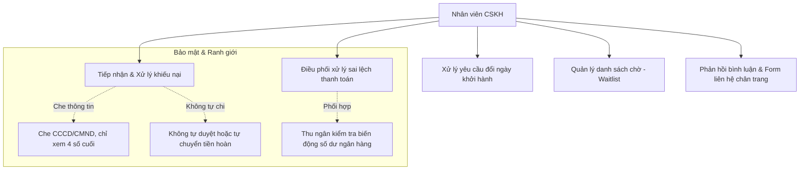
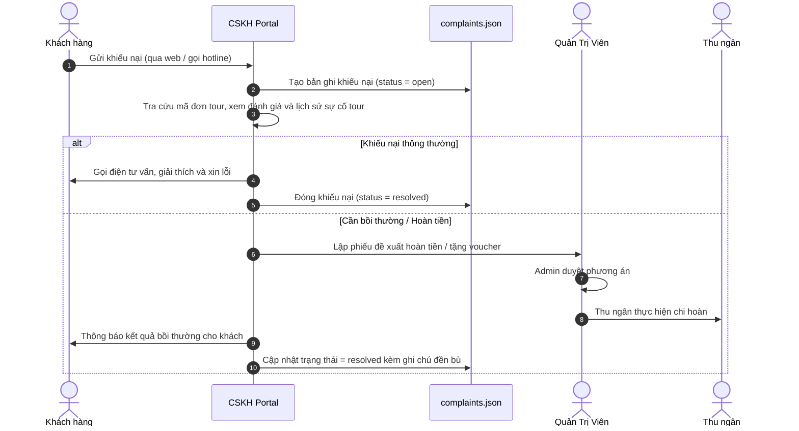
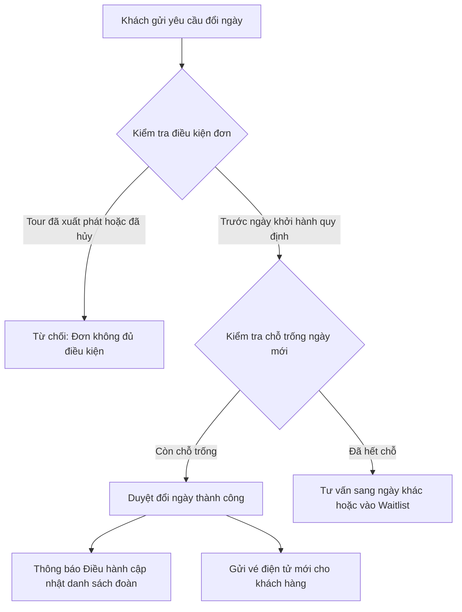

# Workflow 13 — Chăm Sóc Khách Hàng (CSKH & Hỗ Trợ)

Tài liệu này mô tả chi tiết quy trình tiếp nhận, xử lý khiếu nại, hỗ trợ đổi ngày, quản lý danh sách chờ và phân loại phản hồi của nhân viên **Chăm Sóc Khách Hàng (CSKH)** tại portal `/staff/support.html`.

---

## 1. Ranh giới trách nhiệm & Phân quyền

- **Quyền hạn chính**: Tiếp nhận ticket hỗ trợ, phản hồi khách hàng, hỗ trợ đổi ngày đi tour, đề xuất bồi thường (voucher/hoàn tiền một phần), ẩn bình luận vi phạm và chuyển việc cho bộ phận chuyên trách.
- **Ranh giới bảo mật**: Thông tin cá nhân nhạy cảm (CCCD/hộ chiếu đầy đủ) được che mờ tự động. CSKH không có quyền tự ý duyệt lệnh chi tiền hoàn từ Quỹ lưu động (phải trình Admin duyệt, Thu ngân chi).

---

## 2. Quy trình xử lý Khiếu nại (Complaints Management)

Dữ liệu khiếu nại lưu trữ tại `complaints.json`.

### 2.1 Các cấp độ nghiêm trọng của khiếu nại
- **Mức Thấp (`low`)**: Góp ý về suất ăn nhẹ, câu hỏi về xe đón trễ dưới 15 phút. CSKH giải thích và cảm ơn góp ý.
- **Mức Trung bình (`medium`)**: Khách phàn nàn phòng khách sạn ồn, thái độ phục vụ chưa chu đáo. CSKH liên hệ trực tiếp, tặng voucher ưu đãi cho chuyến đi sau.
- **Mức Cao (`high`)**: Sự cố an toàn, tai nạn, hủy dịch vụ đột xuất không báo trước. CSKH lập tức thông báo Điều hành & Admin, lập hồ sơ đề xuất bồi thường.

---

## 3. Xử lý yêu cầu Đổi ngày khởi hành (Reschedule Requests)

Khách hàng xin dời ngày đi tour do việc đột xuất (ví dụ đơn `bk_1080`, `bk_1081`, `bk_1082`):

- **Quy tắc tính phụ phí**:
  - Đổi ngày trước 7 ngày: Miễn phí đổi ngày lần đầu.
  - Đổi ngày từ 3 - 6 ngày: Thu phí chênh lệch hoặc phí giữ chỗ theo chính sách.
  - Đổi cận ngày (dưới 72h): Chuyển Điều hành kiểm tra khả năng hủy dịch vụ bên thứ ba (vé máy bay, phòng khách sạn).

---

## 4. Quản lý Hàng đợi Danh sách chờ (Waitlist)

Dữ liệu lưu tại `waitlist.json`:
- Khi một tour đã **hết chỗ** (`full`), khách hàng có thể bấm **Đăng ký chờ**.
- Khi có hành khách khác hủy tour hoặc Điều hành mở thêm sức chứa xe:
  1. Hệ thống ưu tiên theo thứ tự thời gian đăng ký (FIFO).
  2. CSKH nhận thông báo có chỗ trống.
  3. CSKH gọi điện xác nhận trong vòng 2 giờ; nếu khách đồng ý, tạo đơn đặt tour chính thức và gửi link thanh toán.
  4. Nếu khách từ chối, chuyển sang người tiếp theo trong hàng đợi.

---

## 5. Phối hợp xử lý Sai lệch thanh toán (Payment Discrepancies)

Trường hợp khách hàng chuyển khoản nhưng sai cú pháp, thừa hoặc thiếu tiền:
- Dữ liệu tra cứu tại `payments.json`.
- **Thiếu tiền**: CSKH nhắn tin / gọi điện gửi hướng dẫn khách chuyển bù số tiền còn thiếu kèm mã giao dịch.
- **Thừa tiền**: CSKH đối soát với Thu ngân, tạo phiếu hoàn lại số tiền thừa về tài khoản nguồn của khách hoặc cộng vào ví số dư tài khoản.
- **Sai cú pháp / Không nhận diện được đơn**: CSKH yêu cầu khách gửi ảnh chụp biên lai ngân hàng, phối hợp Thu ngân đối chiếu giờ giao dịch và gán thủ công vào đơn tour.

---

## 6. Phân quyền Bình luận & Hỗ trợ Form chân trang

- **Bộ lọc làm việc chính**: **"Cần xử lý"** (tập trung vào các câu hỏi chưa ai giải đáp hoặc phản hồi tiêu cực).
- **Phân loại nhãn (Tags)**: `Hỏi thông tin`, `Đánh giá`, `Khiếu nại`, `Góp ý`.
- **Ẩn vi phạm**: CSKH có quyền ẩn ngay các bình luận thô tục, spam quảng cáo để giữ gìn hình ảnh công ty.
- **Form chân trang (Footer Feedback)**: Tiếp nhận các câu hỏi tư vấn từ khách vãng lai, liên hệ lại qua email hoặc số điện thoại trong vòng tối đa 30 phút.
