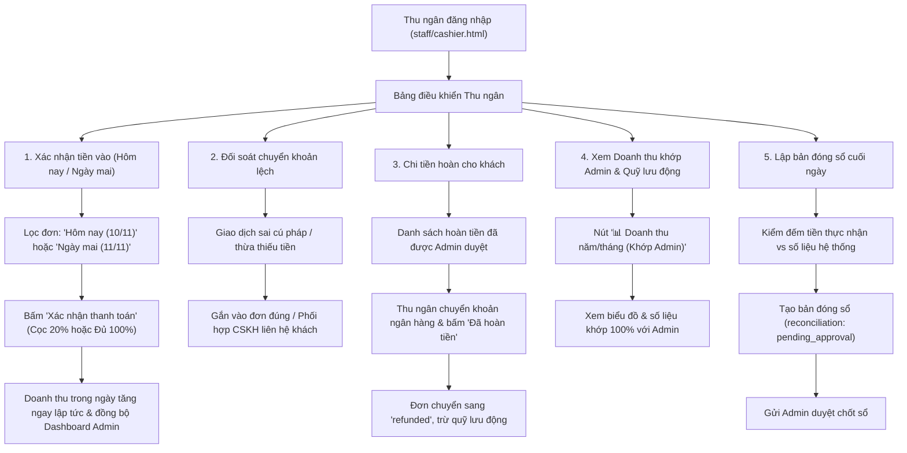

# Workflow 14 — Thu ngân (Cashier Operations)

Tài liệu mô tả toàn bộ quy trình thu chi, đối soát thanh toán, hoàn tiền, chốt sổ cuối ngày và quản lý quỹ lưu động của vai trò Thu ngân.

---

## 1. Sơ đồ luồng Thu ngân

---

## 2. Các quy định và nghiệp vụ trọng yếu

### 2.1. Xác nhận tiền & Tăng doanh thu tức thì
* Bộ lọc ngày trực quan: Hỗ trợ nút chọn nhanh **Hôm nay** và **Ngày mai**.
* Khi khách hàng chuyển khoản trực tiếp qua ngân hàng hoặc nộp tiền mặt tại quầy, Thu ngân bấm **"Xác nhận thanh toán"**.
* Tiền được hạch toán ngay vào sổ doanh thu (`daily_revenues.json`), kích hoạt cập nhật biểu đồ doanh thu theo thời gian thực.
* Quyền hoàn tác giao dịch: Trong vòng 15 phút đầu nếu bấm nhầm, Thu ngân có thể bấm Hoàn tác và bắt buộc nhập lý do.

### 2.2. Đồng bộ số liệu 1:1 với Quản trị viên (Admin)
* Thu ngân được cấp quyền truy cập các API thống kê: `/api/stats` và `/api/cashier/stats-overview`.
* Nút **`📊 Doanh thu năm/tháng (Khớp Admin)`** cho phép Thu ngân mở popup tra cứu số liệu doanh thu chốt duyệt, thực thu và chi trả lương trùng khớp từng đồng với màn hình Tổng quan của Admin.

### 2.3. Quy tắc hai lớp duyệt hoàn tiền (Maker - Checker)
* Thu ngân **không tự ý quyết định hoàn tiền** mà chỉ thực hiện chi trả khi yêu cầu hoàn tiền đã có trạng thái `approved` từ Admin.
* Sau khi chuyển khoản xong, Thu ngân bấm "Đã hoàn tiền" kèm mã tham chiếu ngân hàng để chuyển trạng thái sang `refunded`.

### 2.4. Đóng sổ cuối ngày (`Reconciliation`)
* Cuối ca làm việc, Thu ngân tổng kết các khoản thực thu trong ngày và tạo bản ghi đóng sổ.
* **Nguyên tắc kiểm soát nội bộ:** Người lập bản đóng sổ không được tự duyệt bản đóng sổ của chính mình. Bản đóng sổ sẽ chuyển sang Admin ở trạng thái `pending_approval` để duyệt chốt sổ.
