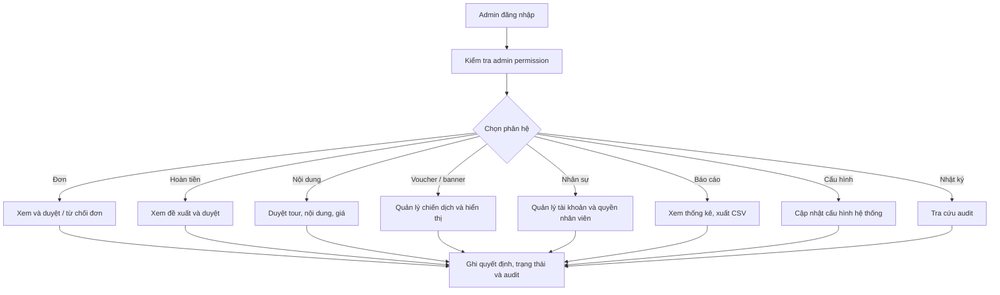

# Workflow 16 — Quản trị viên

Admin không xác nhận giao dịch ngân hàng và không tự thực hiện chuyển tiền hoàn; các thao tác đó thuộc Thu ngân.

Admin làm việc tại `/staff/admin.html`. Khi phiên Admin còn hiệu lực, truy cập trang chủ/giao diện khách hoặc dashboard của vai trò khác sẽ chuyển về dashboard Admin; muốn vào website khách cần đăng xuất phiên nội bộ.
