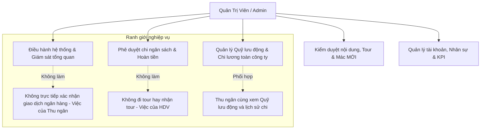
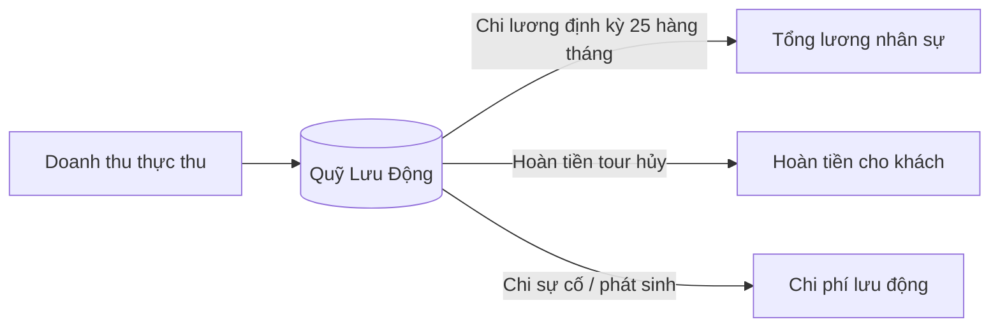
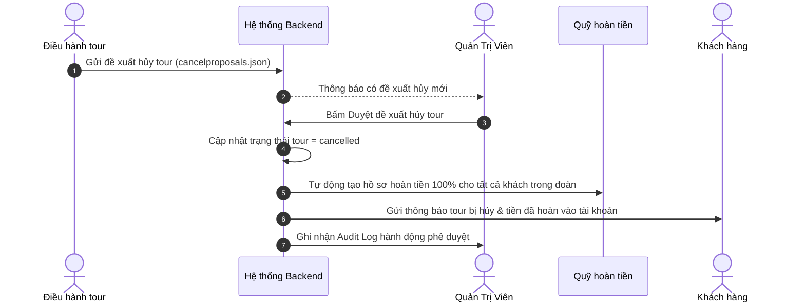

# Workflow 16 — Quản Trị Viên (Admin)

Tài liệu này mô tả toàn diện nghiệp vụ điều hành cấp cao của Quản Trị Viên (**Admin**) tại portal `/staff/admin.html`.

---

## 1. Nguyên tắc phân quyền và ranh giới nghiệp vụ

- **Đặc quyền Admin**: Toàn quyền cấu hình hệ thống, kiểm duyệt nội dung, duyệt hoàn tiền, duyệt đề xuất hủy tour của Điều hành, chi lương toàn thể nhân sự và giám sát Quỹ lưu động.
- **Ranh giới tài chính**: Admin duyệt chi / duyệt hoàn tiền (`approved`), nhưng việc bấm xác nhận chi tiền thực tế từ tài khoản ngân hàng hoặc tiền mặt do **Thu ngân** thực hiện (`paid`).
- **Khóa điều hướng nội bộ**: Khi phiên Admin còn hiệu lực, truy cập trang chủ khách hàng sẽ tự động giữ phiên hoặc chuyển về dashboard Admin; để dùng tài khoản khách cần đăng xuất.

---

## 2. Quỹ lưu động & Đối soát doanh thu thực tế

### 2.1 Công thức đồng bộ Quỹ lưu động
Quỹ lưu động của công ty tại mục **Quỹ & Tài chính** trên Dashboard Admin và Thu ngân hiển thị đồng bộ tuyệt đối theo công thức:

$$\text{Quỹ lưu động} = \text{Doanh thu thực thu} - \text{Đã hoàn tiền} - \text{Tổng lương đã chi} - \text{Chi phí lưu động khác}$$

- **Doanh thu thực thu**: Tổng số tiền các đơn đặt tour đã thanh toán đủ (`paid_full`) hoặc đã đặt cọc (`deposited`), khớp đúng với dữ liệu Thu ngân xác nhận.
- **Lịch sử chi tiền lưu động**: Ghi nhận chi tiết từng khoản chi (chi trả lương, hoàn tiền hủy tour, chi công tác phí, chi dịch vụ đối tác) theo từng năm và danh mục chi.
- **Phân quyền xem**: Chỉ có **Admin** và **Thu ngân** mới có quyền xem thông tin số tiền lưu động và báo cáo đối soát.

### 2.2 Duyệt chốt sổ cuối ngày (Reconciliations)
- Thu ngân gửi phiếu chốt sổ sau ca làm việc kèm file sao kê và ghi chú số dư thực tế.
- Admin xem danh sách chốt ca:
  - Nếu số liệu khớp: Bấm **Duyệt chốt ca**.
  - Nếu lệch tiền: Bấm **Yêu cầu giải trình** (bắt buộc nhập lý do từ chối để Thu ngân điều chỉnh).

---

## 3. Bảng lương toàn công ty & Xét tăng lương KPI

### 3.1 Chi lương toàn bộ nhân sự (`pay-all`)
- **Nút bấm một chạm**: `[Chi lương toàn bộ nhân sự]` (`/api/admin/salaries/pay-all`).
- **Quy tắc ngày 25**: Hệ thống kiểm tra ngày trong tháng. Nếu chưa đến ngày 25 hàng tháng, hệ thống hiển thị cảnh báo xác nhận trước khi thực hiện.
- **Tác động tự động**:
  1. Cộng dồn lương cơ bản vào ví số dư (`balance`) của từng nhân viên (Admin, Thu ngân, Điều hành, CSKH, Biên tập, HDV).
  2. Tự động ghi nhận log chi lương vào `salary_logs.json`.
  3. Trừ trực tiếp vào Quỹ lưu động của công ty và cập nhật biểu đồ chi phí trên Dashboard.
  4. Gửi thông báo có chuông tới từng tài khoản nhân viên được nhận lương.

### 3.2 Lịch sử trả lương và rút tiền
- Mỗi nhân viên có hồ sơ tài chính riêng: **Lương cơ bản**, **Số dư hiện tại**, **Tổng đã nhận lũy kế**.
- Lịch sử rút tiền của nhân viên phải đối soát khớp chính xác với biến động số dư và lệnh chi của Thu ngân.

### 3.3 Đánh giá KPI & Tăng lương
- Admin xem bảng xếp hạng KPI nhân sự (tính từ đánh giá của khách, số tour hoàn thành không sự cố, số khiếu nại đã giải quyết).
- Tăng bậc lương: Khi nhân viên đạt KPI xuất sắc qua 2 kỳ liên tiếp, Admin kích hoạt xét tăng lương với ghi chú quyết định lưu vào Audit Log.

---

## 4. Duyệt đề xuất hủy tour của Điều hành

Khi Điều hành gửi đề xuất hủy tour (do thiếu HDV, thời tiết cực đoan hoặc không đủ số lượng tối thiểu):

- **Chính sách 100%**: Khi Admin duyệt hủy tour từ phía công ty, khách hàng được hoàn 100% giá trị đã thanh toán mà không mất bất kỳ khoản phí phạt nào.

---

## 5. Quản lý danh mục Tour & Hạn mác "MỚI"

### 5.1 Thời hạn mác "MỚI" (New Badge Lifecycle)
- **Hạn mặc định**: 30 ngày kể từ ngày khởi tạo tour (`newUntil = createdAt + 30 ngày`).
- **Tùy chỉnh hạn**: Tại form tạo/sửa tour, Admin có thể trực tiếp chọn ngày hết hạn mác "MỚI".
- **Hiển thị trực quan**: Trên trang chủ và trang danh sách, badge hiển thị rõ `MỚI (đến dd/mm)`. Sau ngày hết hạn, badge tự động biến mất mà không cần thao tác tay.

### 5.2 Ẩn / Hiện tour
- Khi Admin chọn **Ẩn tour**: Tour chuyển sang trạng thái tạm đóng, không xuất hiện ở trang tìm kiếm của khách hàng.
- Khi chọn **Hiện lại**: Tour tái kích hoạt ở vị trí cũ, giữ nguyên mã định danh và thông tin đặt tour hiện có, không bị nhân bản thành tour trùng lặp.

---

## 6. Phân quyền xử lý Bình luận & Đánh giá

Phân định rõ ranh giới giữa Admin và đội ngũ CSKH/Biên tập:

| Tính năng | Biên tập & CSKH | Admin |
| :--- | :---: | :---: |
| **Xem bình luận & đánh giá** | Có | Có |
| **Trả lời khách hàng** | Có | Có |
| **Gắn loại bình luận** *(Hỏi / Đánh giá / Khiếu nại / Góp ý)* | Có | Có |
| **Ẩn bình luận vi phạm tiêu chuẩn** | Có | Có |
| **Chuyển vấn đề cho bộ phận khác** | Có | Có |
| **Lọc theo ưu tiên "Cần xử lý"** | Có (Mặc định) | Có |
| **Xóa vĩnh viễn bình luận** | Không | **Độc quyền Admin** |
| **Cấu hình bộ từ khóa lọc / chặn** | Không | **Độc quyền Admin** |
| **Xem danh tính người đã xử lý & Lịch sử audit** | Không | **Độc quyền Admin** |

---

## 7. Quản trị Voucher & Khuyến mãi

- **Tạo mã giảm giá linh hoạt**: Giảm theo số tiền cố định (VNĐ) hoặc phần trăm (%), kèm giá trị đơn hàng tối thiểu và mức giảm tối đa.
- **Đối tượng áp dụng**:
  - Toàn bộ khách hàng.
  - Phân nhóm khách hàng thân thiết / VIP.
  - Tặng thưởng riêng cho nhân viên xuất sắc.
- **Hạn sử dụng và số lượt dùng**: Giới hạn tổng số lượt sử dụng và số lần tối đa mỗi tài khoản được áp dụng.

---

## 8. Nhật ký kiểm toán (Audit Trail)

Mọi thao tác quản trị nhạy cảm đều được ghi lại vào `audit_logs.json` bằng tiếng Việt rõ ràng:
- **Tác vụ được ghi**: Duyệt hoàn tiền, duyệt hủy tour, chi lương toàn công ty, đổi vai trò nhân viên, xóa đánh giá, thay đổi cấu hình hệ thống.
- **Dữ liệu lưu vết**: `actorId`, `actorName`, `actorRole`, `action`, `targetId`, `detail`, `timestamp`, `ipAddress`.
