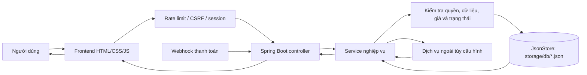

# Workflow 17 — Kiến trúc API và dữ liệu

Request ghi cần đúng phiên, quyền và origin. Dữ liệu riêng tư nằm trong `backend/storage`, không được phục vụ như tệp frontend. Dịch vụ ngoài gồm AI/RAG, bản đồ/địa điểm, tìm vé/khách sạn và email/OTP.
