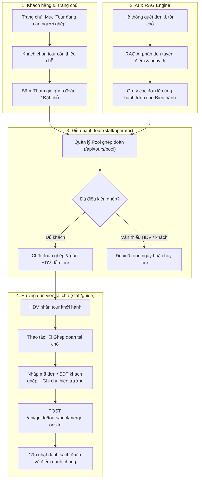

# Workflow 18 — Ghép tour, Dồn đoàn & AI RAG hỗ trợ ghép khách

Tài liệu mô tả quy trình ghép đoàn (Tour Pooling) đa vai trò: Khách hàng đăng ký ghép tour thiếu người trên trang chủ, AI / RAG gợi ý ghép tự động, Điều hành tour gom đoàn và Hướng dẫn viên ghép khách tại hiện trường.

---

## 1. Mục tiêu nghiệp vụ
* **Đảm bảo khởi hành:** Giúp các đoàn tour chưa đạt số khách tối thiểu (`minGuests`) gom đủ người để khởi hành đúng lịch, tránh phải hủy tour.
* **Tiết kiệm chi phí:** Khách đi theo nhóm nhỏ (1–3 người) có thể ghép chung đoàn để hưởng mức giá ưu đãi của đoàn đông.
* **Linh hoạt hiện trường:** HDV có thể xử lý gộp xe, ghép tuyến trung chuyển ngay khi đang dẫn tour.

---

## 2. Sơ đồ luồng Ghép đoàn tổng thể

---

## 3. Chi tiết các điểm chạm nghiệp vụ

### 3.1. Phía Khách hàng (Trang chủ)
* API: `GET /api/tours/pool` trả về danh sách các nhóm tour đang mở ghép (`tour_pools.json`).
* Mỗi thẻ ghép tour hiển thị: Tên tour, Ngày khởi hành, Số khách hiện có / Số khách mục tiêu, Số chỗ còn thiếu, Mức giá tiết kiệm.
* Khách bấm tham gia ghép sẽ được đưa thẳng vào luồng đặt tour với mã nhóm ghép (`poolId`).

### 3.2. Phía AI & RAG Engine
* Thuật toán quét các đơn đặt tour ở trạng thái `paid_deposit` hoặc `paid_full` nhưng chưa đủ `minGuests`.
* So khớp vector tuyến điểm tương đồng (ví dụ: tour Hà Nội – Hạ Long và Hạ Long 2N1Đ) và ngày khởi hành chênh lệch $\pm 1$ ngày.
* Đưa ra gợi ý thông minh cho Điều hành tour để chủ động liên hệ khách hoặc gom đơn.

### 3.3. Phía Điều hành tour (`staff/operator.html`)
* Theo dõi thanh tiến độ gom khách theo từng tour.
* Khi đoàn đạt đủ số khách tối thiểu, Điều hành khóa nhóm ghép (`status = locked / confirmed`) và tiến hành phân công HDV.

### 3.4. Phía Hướng dẫn viên (`staff/guide.html`)
* Khi đang dẫn tour hoặc chuẩn bị xuất bến, HDV có nút **`🤝 Ghép đoàn tại chỗ`** trên thẻ tour:
  * Nhập mã đơn / số điện thoại khách ghép thêm.
  * Nhập số khách ước tính ghép vào đoàn.
  * Ghi chú lý do hiện trường (gộp xe trung chuyển, đoàn phát sinh).
  * Hệ thống tự động ghi nhận vào lịch sử đoàn và cập nhật danh sách hành khách đi chung.

