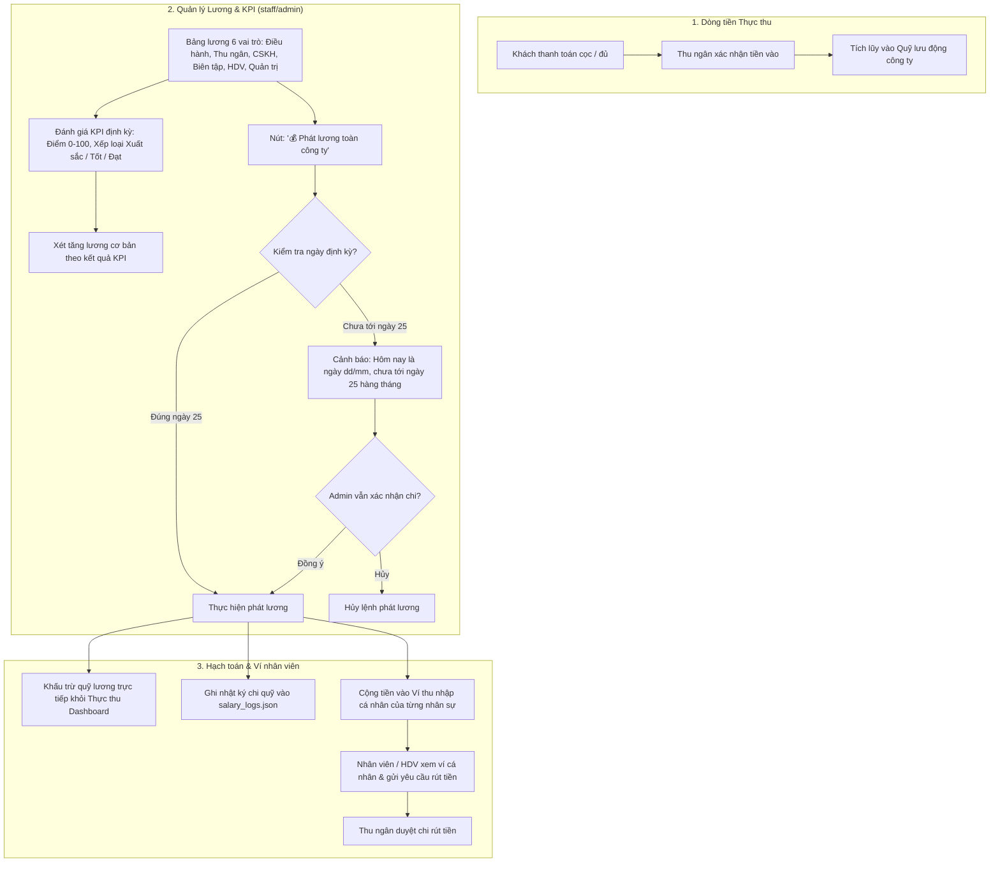

# Workflow 19 — Quỹ lưu động công ty, Quản lý lương & Đánh giá KPI

Tài liệu mô tả quy trình quản lý dòng tiền quỹ lưu động, vận hành bảng lương nhân sự 6 vai trò, đánh giá tăng lương định kỳ theo KPI và cơ chế khấu trừ tự động vào Dashboard doanh thu.

---

## 1. Nguyên tắc cốt lõi
1. **Khớp số thực thu:** Số dư quỹ lưu động phải đồng nhất với tổng số tiền thực thu sau khi đã trừ đi các khoản hoàn tiền, chi phí vận hành và chi trả lương.
2. **Phân quyền truy cập quỹ:** Chỉ **Admin** và **Thu ngân** mới có quyền xem số dư quỹ lưu động và lịch sử các khoản chi quỹ.
3. **Liên kết Dashboard tự động:** Khi phát lương nhân viên hoặc duyệt hoàn tiền, số tiền được tự động trừ ngay vào chỉ số Thực thu trên Dashboard.
4. **Bảo toàn thu nhập nhân viên:** Tổng thu nhập tích lũy (`totalEarned`) = Lương cơ bản + Thù lao tour + Thưởng - Phạt. Số dư ví (`balance`) = Tổng thu nhập - Tổng số tiền đã rút thành công.

---

## 2. Sơ đồ luồng Quỹ lưu động & Phát lương

---

## 3. Các thành phần chi tiết

### 3.1. Quỹ lưu động công ty (`Working Capital`)
* **Công thức xác định:**
  $$\text{Quỹ lưu động} = \text{Tổng thực thu} - \text{Tổng tiền đã hoàn} - \text{Tổng chi trả lương} - \text{Chi phí vận hành}$$
* **Lịch sử chi quỹ:** Bảng kê chi tiết từng dòng tiền xuất quỹ:
  * Chi phát lương định kỳ toàn công ty.
  * Chi thưởng nhân viên xuất sắc / Thù lao tour cho HDV.
  * Chi hoàn tiền đơn hủy cho khách hàng.
  * Chi phí dịch vụ đối tác (xe trung chuyển, khách sạn).

### 3.2. Quản lý Lương & KPI nhân sự (`staff/admin.html#salaries`)
* **Bảng lương theo từng phòng ban:** Xem danh sách nhân viên theo từng vai trò (Điều hành, Thu ngân, CSKH, Biên tập, HDV, Quản trị).
* **Đánh giá KPI định kỳ:**
  * Mỗi nhân viên có hồ sơ KPI: Điểm KPI gần nhất, ngày xét lương tiếp theo, hợp đồng lao động.
  * Modal xét lương hiển thị: Tỷ lệ tăng lương đề xuất theo kết quả KPI (+5%, +10%...), mức lương mới dự kiến.
  * Lưu trữ vĩnh viễn lịch sử các lần tăng/giảm lương và lý do căn cứ.
* **Quy tắc ngày phát lương:**
  * Ngày phát lương định kỳ cố định: **Ngày 25 hàng tháng**.
  * Nếu phát lương trước ngày 25, hệ thống bật popup cảnh báo xác nhận của Ban Giám Đốc.
  * Lược bỏ nút phát lương đơn lẻ từng vai trò để tránh phân mảnh dòng tiền; tập trung vào nút chuẩn: **`💰 Phát lương toàn công ty`**.

### 3.3. Ví thu nhập & Lịch sử rút tiền của nhân viên
* Nhân viên và Hướng dẫn viên có mục **Ví & Thu nhập** riêng (`#my-wallet`):
  * **HDV:** Hưởng lương cứng (nếu là nhân viên chính thức) + **20% thù lao dẫn tour** cho mỗi tour hoàn thành.
  * **Nhân viên văn phòng:** Hưởng lương định kỳ + thưởng KPI.
* Thao tác rút tiền: Nhân viên tạo yêu cầu rút tiền $\rightarrow$ Thu ngân kiểm tra và duyệt chuyển khoản $\rightarrow$ Số dư ví giảm tương ứng.

